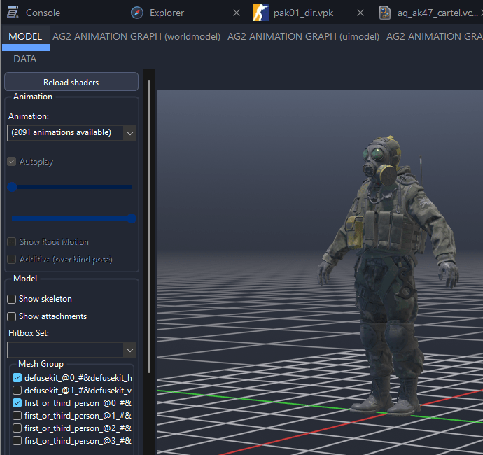
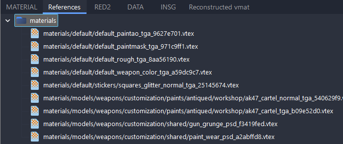
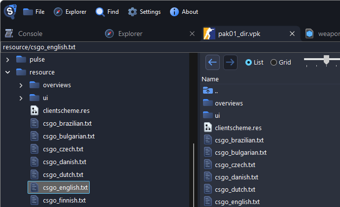
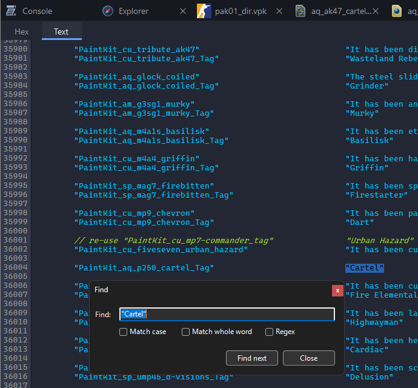
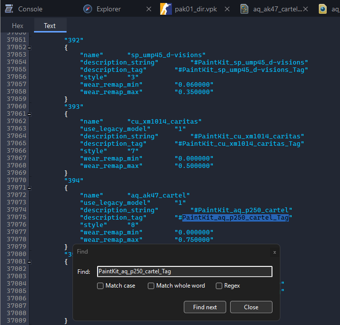
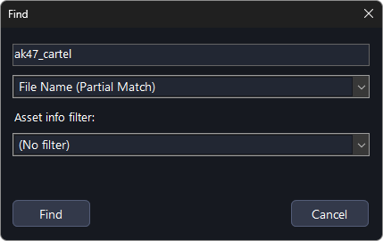
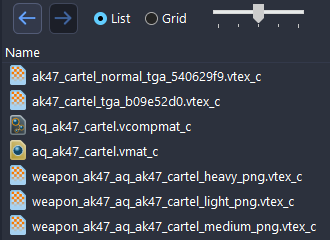

# Extract Counter-Strike 2 Files, Models and Maps

This page shows where Counter-Strike 2 keeps its files and how to find the files of an item you know from the game. To open a package and find a file in it, see [Finding Game Files](../guides/finding-files.md).

## Where the Files Are

Counter-Strike 2 installs into `steamapps/common/Counter-Strike Global Offensive/`, with its files in `game/csgo/`.

| What                                               | Where                                                             |
| -------------------------------------------------- | ----------------------------------------------------------------- |
| Models, textures, sounds, the interface, item data | `game/csgo/pak01_dir.vpk`                                         |
| Official maps                                      | `game/csgo/maps/<map>.vpk`, such as `game/csgo/maps/de_dust2.vpk` |
| Models and materials of community maps             | `game/csgo_community_addons/<map>/<map>_dir.vpk`                  |
| Workshop items                                     | `steamapps/workshop/content/730/<item id>/`                       |

## What's Inside pak01_dir.vpk

| Files                        | Path inside the package                                                        |
| ---------------------------- | ------------------------------------------------------------------------------ |
| Weapons                      | `weapons/models/<weapon>/`, such as `weapons/models/ak47/`                     |
| Knives                       | `weapons/models/knife/<knife>/`                                                |
| Grenades                     | `weapons/models/grenade/<grenade>/`                                            |
| Agents (player models)       | `agents/models/<faction>/`, such as `agents/models/ctm_sas/`                   |
| Agent materials and textures | `characters/models/<faction>/materials/`                                       |
| Gloves                       | `agents/models/shared/arms/<glove>/`                                           |
| Props and world models       | `models/`                                                                      |
| Weapon finishes (skins)      | `weapons/paints/<folder>/`, such as `weapons/paints/legacy/`                   |
| Glove finishes               | `gloves/paints/`                                                               |
| Finish textures              | `materials/models/weapons/customization/paints/` and `items/assets/paintkits/` |
| Stickers                     | `stickers/<tournament or collection>/`, such as `stickers/cologne2026/`        |
| Charms                       | `weapons/keychains/<collection>/`                                              |
| Coins, pins and trophies     | `models/inventory_items/`                                                      |
| Inventory icons              | `panorama/images/econ/`                                                        |
| Weapon sounds                | `sounds/weapons/<weapon>/`                                                     |
| Player sounds                | `sounds/player/`                                                               |
| Music kits                   | `sounds/music/<kit>/`, such as `sounds/music/3kliksphilip_01/`                 |
| Voice lines                  | `sounds/vo/agents/<voice>/`                                                    |
| Announcer                    | `sounds/vo/announcer/`                                                         |
| Item definitions             | `scripts/items/items_game.txt`                                                 |
| Item names                   | `resource/csgo_english.txt`, other languages in `resource/csgo_<language>.txt` |

## Agents

Player models are in `agents/models/`, one folder per faction, such as `ctm_sas` and `tm_phoenix`. Each agent is a model in its faction's folder, such as `ctm_sas_variantf.vmdl_c` for B Squadron Officer. To find an agent by name, see [Finding an Item by Its Name](#finding-an-item-by-its-name).

::: warning
The agent models in `characters/models/`, such as `characters/models/ctm_sas/`, are only placeholder cubes. Use the ones in `agents/models/`.
:::

The export includes all of the agent's animations, which makes it large, see [Exporting Animations](../guides/exporting-models.md#exporting-animations). It also includes the first-person arms and a defuse kit, see [Extra meshes in Blender](../guides/exporting-models.md#extra-meshes-in-blender).

## Gloves

Gloves are separate models in `agents/models/shared/arms/`:

| Folder              | Gloves             |
| ------------------- | ------------------ |
| `glove_bloodhound`  | Bloodhound Gloves  |
| `glove_brokenfang`  | Broken Fang Gloves |
| `glove_fingerless`  | Default T Gloves   |
| `glove_handwrap`    | Hand Wraps         |
| `glove_hardknuckle` | Default CT Gloves  |
| `glove_hydra`       | Hydra Gloves       |
| `glove_motorcycle`  | Moto Gloves        |
| `glove_slick`       | Driver Gloves      |
| `glove_specialist`  | Specialist Gloves  |
| `glove_sporty`      | Sport Gloves       |

Apart from the default gloves, they look plain dark gray, because the game paints them with a [finish](#weapon-skins).

## Weapons and Knives

Each gun has a folder in `weapons/models/`, such as `ak47` with `weapon_rif_ak47.vmdl_c`. Most guns have their magazine as a separate model. Some folders are named differently from the game: `elite` is the Dual Berettas, `hkp2000` the P2000, `revolver` the R8 Revolver, `sg556` the SG 553, `taser` the Zeus x27 and `healthshot` the Medi-Shot.

Grenades are in `weapons/models/grenade/`, and knives in `weapons/models/knife/`. Most knife folders are named after the knife, such as `knife_karambit`. These are not:

| Folder                                | Knife                       |
| ------------------------------------- | --------------------------- |
| `knife_canis`                         | Survival Knife              |
| `knife_cord`                          | Paracord Knife              |
| `knife_css`                           | Classic Knife               |
| `knife_m9`                            | M9 Bayonet                  |
| `knife_outdoor`                       | Nomad Knife                 |
| `knife_push`                          | Shadow Daggers              |
| `knife_tactical`                      | Huntsman Knife              |
| `knife_default_ct`, `knife_default_t` | The default CT and T knives |

To use a weapon in Blender, see [Exporting Models](../guides/exporting-models.md). The export includes its animations, such as `reload` and `inventory_inspect`.

## Weapon Skins

A skin's finish is a composite material (`.vcompmat_c`) in `weapons/paints/`, or `gloves/paints/` for gloves. It is named after its paint kit, such as `aq_ak47_cartel.vcompmat_c` for the AK-47 | Cartel.

Double-click a finish to read it. In older finishes, `m_strSpecificContainerMaterial` names a material in `materials/models/weapons/customization/paints/vmats/`, whose [References](../guides/finding-files.md#references) tab lists the textures:

Newer finishes list their textures themselves, mostly in `items/assets/paintkits/`. See [Exporting Textures](../guides/exporting-textures.md).

Source 2 Viewer cannot show or export a weapon with a skin applied.

The inventory icons of the finishes are in `panorama/images/econ/default_generated/`, one per wear level, such as `weapon_ak47_aq_ak47_cartel_light_png.vtex_c`.

## Finding an Item by Its Name

Files use internal names, not the names you see in the game. Two text files in `pak01_dir.vpk` connect them. This example finds the files of the AK-47 | Cartel:

1. Type `resource/csgo_english.txt` into the box above the tree, press <kbd>Enter</kbd> and double-click the file. Other languages are in files such as `csgo_german.txt`.

    

2. Press <kbd>Ctrl</kbd>+<kbd>F</kbd> and search for `"Cartel"`. On its left is its key, `PaintKit_aq_p250_cartel_Tag`.

    

3. Open `scripts/items/items_game.txt` and search for the key. **Find next** goes through every finish named Cartel. The AK-47's entry has `name` `aq_ak47_cartel`.

    

4. In the package tab, search for `ak47_cartel`.

    

The results are the finish, its material and textures, and its inventory icons:

For other items, these lines of their entry name the files:

- Agents, gloves and knives: `model_player`
- Stickers: `sticker_material`, a material in `stickers/`
- Music kits: `name`, their folder in `sounds/music/`
- Charms: `pedestal_display_model`, and for community charms `keychain_material`

## Stickers, Charms and Coins

- **Stickers** are materials in `stickers/`, one folder per tournament or collection. Community sticker textures are in `items/assets/stickers/community/`.
- **Charms** are models in `weapons/keychains/`. Community charms share one blank model and differ by their material, with textures in `items/assets/keychains/`.
- **Coins, pins and trophies** are models in `models/inventory_items/`.

Their inventory icons are in `panorama/images/econ/`.

## Music Kits and Voice Lines

Each music kit has a folder in `sounds/music/`, such as `3kliksphilip_01`, with sounds such as `mainmenu.vsnd_c` and `wonround.vsnd_c`.

Agent voice lines are in `sounds/vo/agents/`, one folder per voice, such as `balkan` and `gsg9`. The announcer is in `sounds/vo/announcer/`. To save sounds, see [Exporting Sounds](../guides/exporting-sounds.md).

## Maps

Each official map is a package in `game/csgo/maps/`, such as `de_dust2.vpk`, with the map in `maps/<map>.vmap_c`. See [Exporting Maps](../guides/exporting-maps.md).

Community maps that come with the game, such as `de_boulder`, keep their models and materials in a second package in `game/csgo_community_addons/`. Open the map from `game/csgo/maps/`, and Source 2 Viewer loads the second package with it.
