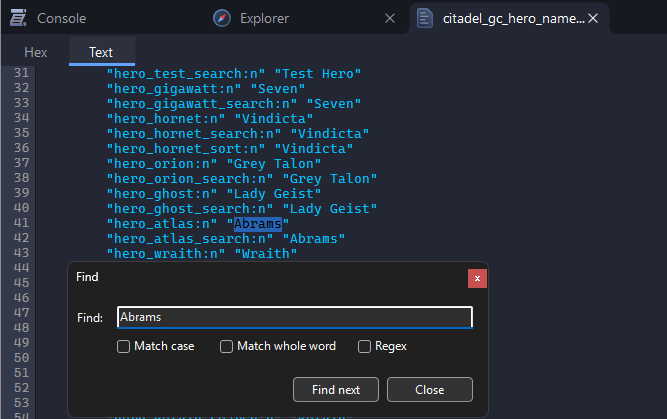
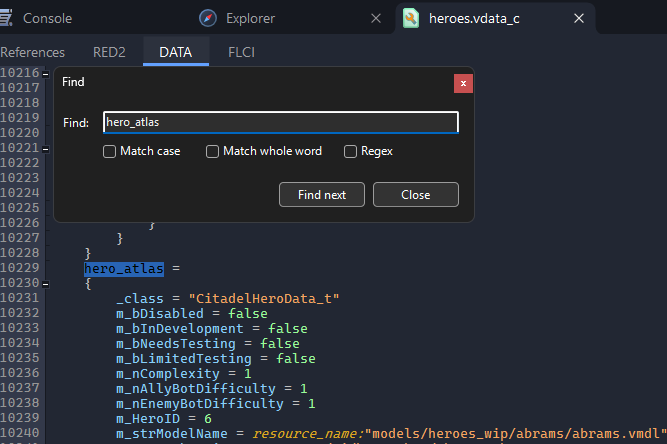
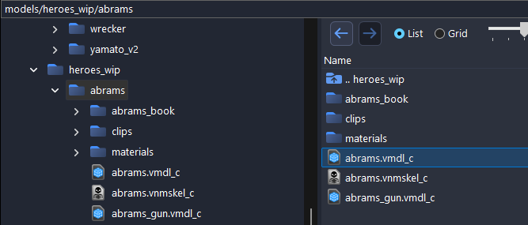

# Extract Deadlock Hero Models, Animations and Files

This page shows where Deadlock keeps its files. To open a package and browse it, see [Finding Game Files](../guides/finding-files.md).

## Where the Files Are

Deadlock installs into `steamapps/common/Deadlock/`, with its files in `game/citadel/`.

| What                    | Where                                                   |
| ----------------------- | ------------------------------------------------------- |
| Heroes, sounds, scripts | `game/citadel/pak01_dir.vpk`                            |
| Maps                    | `game/citadel/maps/<map>.vpk`, such as `dl_midtown.vpk` |

## What's Inside pak01_dir.vpk

| Files             | Path inside the package                                              |
| ----------------- | -------------------------------------------------------------------- |
| Hero models       | `models/heroes_wip/` and `models/heroes_staging/`                    |
| Voice lines       | `sounds/vo/<hero id>/`, such as `sounds/vo/atlas/`                   |
| Announcer         | `sounds/vo/announcer/`                                               |
| Ability sounds    | `sounds/abilities/<hero>/`, such as `sounds/abilities/forge/`        |
| Music             | `sounds/music/`                                                      |
| Hero images       | `panorama/images/heroes/`, such as `archer_card_psd.vtex_c`          |
| Ability particles | `particles/abilities/<hero>/`, such as `particles/abilities/abrams/` |
| Hero data         | `scripts/heroes.vdata_c`                                             |
| Ability data      | `scripts/abilities.vdata_c`                                          |

## Hero Models

Hero models are in `models/heroes_wip/` and `models/heroes_staging/`, one folder per hero. Many folders are not named after the hero:

| Hero       | Hero id       | Model                                           |
| ---------- | ------------- | ----------------------------------------------- |
| Abrams     | `hero_atlas`  | `models/heroes_wip/abrams/abrams.vmdl_c`        |
| Grey Talon | `hero_orion`  | `models/heroes_staging/archer/archer.vmdl_c`    |
| Ivy        | `hero_tengu`  | `models/heroes_wip/ivy/ivy.vmdl_c`              |
| Lady Geist | `hero_ghost`  | `models/heroes_wip/geist/geist.vmdl_c`          |
| Mo & Krill | `hero_krill`  | `models/heroes_staging/digger/digger.vmdl_c`    |
| Vindicta   | `hero_hornet` | `models/heroes_staging/hornet_v3/hornet.vmdl_c` |

Double-click a model to preview it with its animations. To use it in Blender, see [Exporting Models](../guides/exporting-models.md) and [Posing Characters in Blender](../guides/characters-in-blender.md). The export includes all of the hero's animations.

### Finding a Hero's Model

For a hero not in the table:

1. Find the hero's id in `game/citadel/resource/localization/citadel_gc_hero_names/citadel_gc_hero_names_english.txt` in the Deadlock install folder. Drag it onto Source 2 Viewer, press <kbd>Ctrl</kbd>+<kbd>F</kbd> and search for the hero's name. The id is on its left, such as `hero_atlas` for Abrams.

    

2. In `pak01_dir.vpk`, open `scripts/heroes.vdata_c` and search for the id. The `m_strModelName` line of its entry is the model.

    

3. Type the model's folder, such as `models/heroes_wip/abrams`, into the box above the tree and press <kbd>Enter</kbd>.

    

## Voice Lines and Music

Voice lines are in `sounds/vo/`, one folder per hero, named after the hero id without `hero_`, such as `sounds/vo/tengu/` for Ivy. The announcer is in `sounds/vo/announcer/`, and music in `sounds/music/`.

To save sounds as WAV or MP3, see [Exporting Sounds](../guides/exporting-sounds.md).

## Hero and Ability Data

Hero and ability stats are in `scripts/heroes.vdata_c` and `scripts/abilities.vdata_c`. Double-click one to read it in its **DATA** tab, or **Decompile & export** it to a `.vdata` text file.

## Maps

Maps are packages in `game/citadel/maps/`, such as `dl_midtown.vpk`. The map inside is `maps/dl_midtown.vmap_c`. See [Exporting Maps](../guides/exporting-maps.md).
