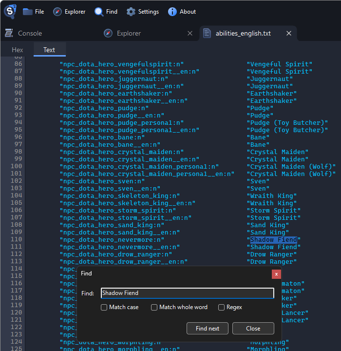
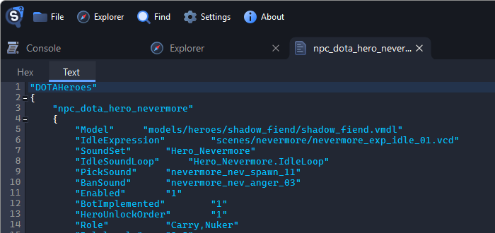
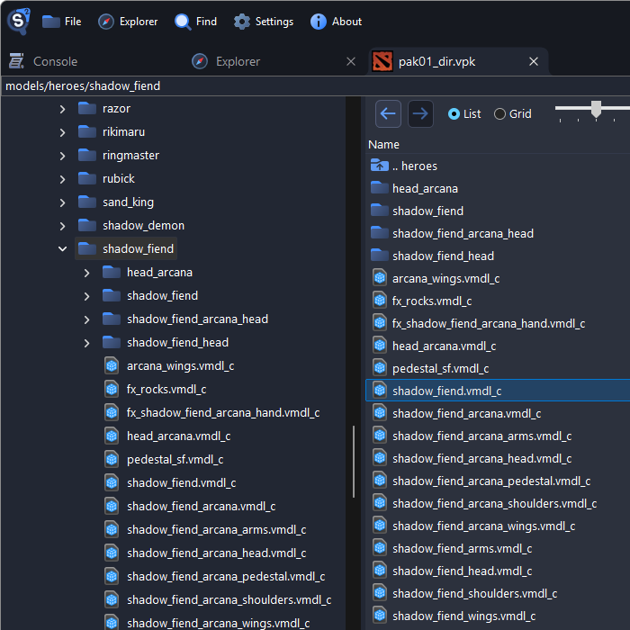
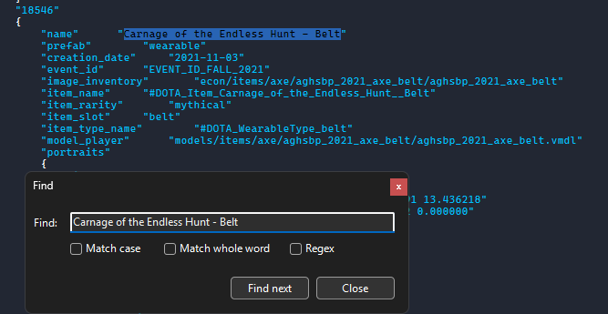
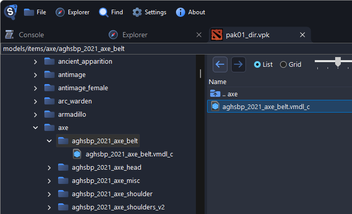
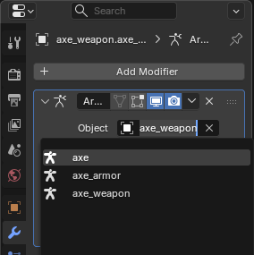
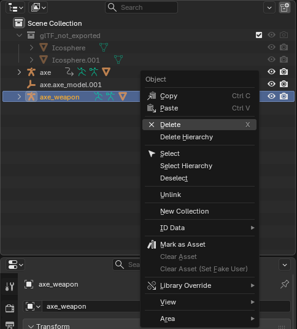
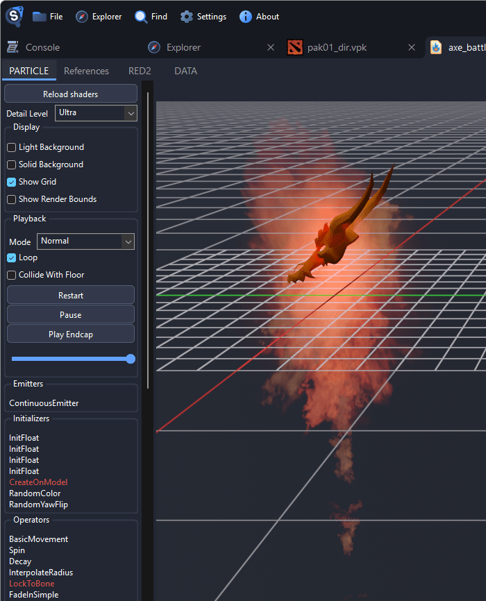
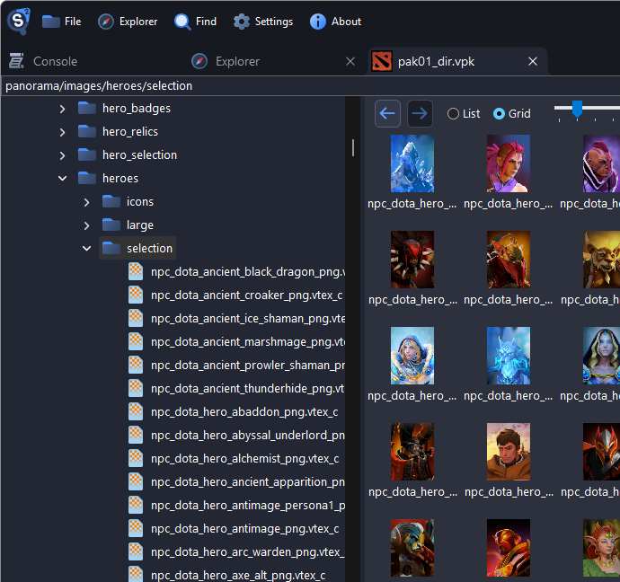

# Extract Dota 2 Hero Models, Cosmetics and Files

This page shows where Dota 2 keeps its files, and how to find a hero or an item. To open a package and browse it, see [Finding Game Files](../guides/finding-files.md).

## Where the Files Are

Dota 2 installs into `steamapps/common/dota 2 beta/`, with its files in `game/dota/`.

| What                                      | Where                                       |
| ----------------------------------------- | ------------------------------------------- |
| Heroes, items, particles, sounds, scripts | `game/dota/pak01_dir.vpk`                   |
| The map                                   | `game/dota/maps/dota.vpk`                   |
| Custom games from the Workshop            | `steamapps/workshop/content/570/<item id>/` |

## What's Inside pak01_dir.vpk

| Files              | Path inside the package                                      |
| ------------------ | ------------------------------------------------------------ |
| Hero models        | `models/heroes/<hero>/`                                      |
| Cosmetic items     | `models/items/<hero>/<item>/`                                |
| Couriers           | `models/courier/` and `models/items/courier/`                |
| Creeps and Roshan  | `models/creeps/`                                             |
| Hero particles     | `particles/units/heroes/hero_<hero>/`                        |
| Cosmetic particles | `particles/econ/items/<hero>/`                               |
| Hero icons         | `panorama/images/heroes/icons/`                              |
| Hero images        | `panorama/images/heroes/` and its `selection/` folder        |
| Item icons         | `panorama/images/econ/items/<hero>/`                         |
| Loading screens    | `panorama/images/loadingscreens/`                            |
| Voice lines        | `sounds/vo/<hero>/`                                          |
| Announcers         | `sounds/vo/announcer/` and `sounds/vo/announcer_dlc_<name>/` |
| Music              | `sounds/music/<pack>/`                                       |
| Hero scripts       | `scripts/npc/heroes/`                                        |
| Item definitions   | `scripts/items/items_game.txt`                               |
| Hero names         | `resource/localization/abilities_english.txt`                |
| Item names         | `resource/localization/items_english.txt`                    |

## Hero Names

Each hero has an internal name, such as `nevermore` for Shadow Fiend, and its folders can use other spellings:

| Hero             | Internal name      | Model folder in `models/heroes/` | Voice lines in `sounds/vo/` |
| ---------------- | ------------------ | -------------------------------- | --------------------------- |
| Clockwerk        | `rattletrap`       | `rattletrap`                     | `rattletrap`                |
| Io               | `wisp`             | `wisp`                           | `wisp`                      |
| Shadow Fiend     | `nevermore`        | `shadow_fiend`                   | `nevermore`                 |
| Templar Assassin | `templar_assassin` | `lanaya`                         | `templar_assassin`          |
| Wraith King      | `skeleton_king`    | `wraith_king`                    | `skeleton_king`             |
| Zeus             | `zuus`             | `zeus`                           | `zuus`                      |

### Finding a Hero's Model

For a hero not in the table:

1. Open `resource/localization/abilities_english.txt` and search for the hero's name. Its id is on the left, such as `npc_dota_hero_nevermore` for Shadow Fiend.

    

2. Open the hero's script, such as `scripts/npc/heroes/npc_dota_hero_nevermore.txt`. Its `Model` line is the hero's model.

    

3. Type the model's folder, such as `models/heroes/shadow_fiend`, into the box above the tree and press <kbd>Enter</kbd>.

    

## Hero Models and Their Parts

Most heroes wear their default items as separate models in the hero's folder, such as `axe_armor.vmdl_c` and `axe_weapon.vmdl_c` next to `axe.vmdl_c`.

To use a hero in Blender, see [Exporting Models](../guides/exporting-models.md) and [Posing Characters in Blender](../guides/characters-in-blender.md). Export the parts too, and attach them as described in [Attaching Items in Blender](#attaching-items-in-blender).

## Cosmetic Items

Cosmetic items are in `models/items/<hero>/`, one folder per item. To find an item by its name:

1. Open `scripts/items/items_game.txt` and search for the item's name, such as `Carnage of the Endless Hunt - Belt`.

    

2. Its `model_player` line is the model. Type its folder into the box above the tree and press <kbd>Enter</kbd>.

    

The `image_inventory` line names the item's icon in `panorama/images/`.

### Attaching Items in Blender

Each hero, part and item has its own armature. To make an item follow the hero:

1. Import the hero and the item into the same scene.
2. Select the item's mesh, and in its **Armature** modifier (the wrench), set **Object** to the hero's armature.

    

3. Delete the item's own armature.

    

The item now moves with the hero. Bone names must match exactly, and some items name bones in lowercase, such as `clavicle_r` for Axe's `clavicle_R`. Rename those under **Vertex Groups** in the **Object Data** properties.

## Particles

Hero effects are in `particles/units/heroes/hero_<hero>/`, and cosmetic effects in `particles/econ/items/<hero>/`. Double-click a `.vpcf_c` file to preview it.

Functions in red are not simulated by the viewer, so the preview can differ from the game.

## Icons, Portraits and Loading Screens

- Hero icons are in `panorama/images/heroes/icons/`, wide images in `panorama/images/heroes/`, and tall portraits in `panorama/images/heroes/selection/`.
- Item icons are in `panorama/images/econ/items/<hero>/`.
- Loading screens are in `panorama/images/loadingscreens/`.

The **Grid** view shows them as thumbnails. To save them as PNG, see [Exporting Textures](../guides/exporting-textures.md).

## Voice Lines, Announcers and Music

Voice lines are in `sounds/vo/<hero>/`, announcers in `sounds/vo/announcer/` and folders such as `sounds/vo/announcer_dlc_glados/`, and music in `sounds/music/`. To save sounds, see [Exporting Sounds](../guides/exporting-sounds.md).

## Maps

The map is `maps/dota.vmap_c` in `game/dota/maps/dota.vpk`. The other `dota` packages hold older versions and seasonal terrains. See [Exporting Maps](../guides/exporting-maps.md).
