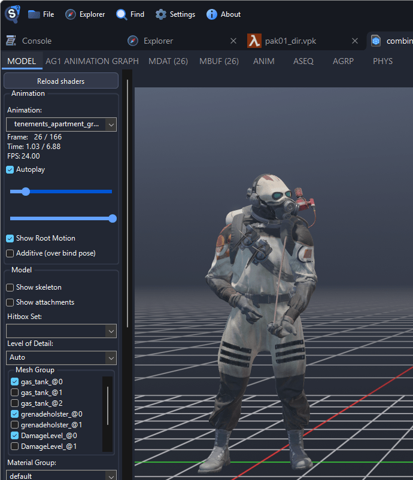

# Extract Half-Life: Alyx Models, Sounds and Maps

This page shows where Half-Life: Alyx keeps its models, sounds and maps. To open a package and browse it, see [Finding Game Files](../guides/finding-files.md).

## Where the Files Are

Half-Life: Alyx installs into `steamapps/common/Half-Life Alyx/`, with its files in `game/hlvr/`.

| What                     | Where                                                    |
| ------------------------ | -------------------------------------------------------- |
| Models, textures, sounds | `game/hlvr/pak01_dir.vpk`                                |
| Maps                     | `game/hlvr/maps/<map>.vpk`, such as `a1_intro_world.vpk` |
| Workshop addons          | `steamapps/workshop/content/546560/<item id>/`           |

## What's Inside pak01_dir.vpk

| Files                | Path inside the package                                    | Example                                       |
| -------------------- | ---------------------------------------------------------- | --------------------------------------------- |
| Characters           | `models/characters/<name>/`                                | `models/characters/alyx/alyx.vmdl_c`          |
| Creatures            | `models/creatures/<name>/`                                 | `models/creatures/headcrab_classic/`          |
| Weapons              | `models/weapons/<name>/`                                   | `models/weapons/vr_alyxgun/vr_alyxgun.vmdl_c` |
| Hands and gloves     | `models/hands/`                                            | `models/hands/alyx_glove_left.vmdl_c`         |
| Props                | `models/props/` and the `models/props_*` folders           | `models/props_combine/`                       |
| Voice lines          | `sounds/vo/<character>/`                                   | `sounds/vo/alyx/`, `sounds/vo/russell/`       |
| Music                | `sounds/music/places/<place>/` and `sounds/music/ambient/` | `sounds/music/places/hideout/`                |
| Developer commentary | `sounds/commentary/`                                       | `sounds/commentary/a2_03_mural.vsnd_c`        |

## Characters, Creatures and Weapons

- **Characters** are in `models/characters/`, such as `alyx`, `eli`, `gman` and `combine_grunt`.
- **Creatures** are in `models/creatures/`, such as `headcrab_classic`, `antlion` and `zombie_classic`.
- **Weapons** are in `models/weapons/`. Alyx's pistol is `vr_alyxgun`, the shotgun `vr_shotgun` and the Rapidfire `vr_ipistol`.

Some models have optional parts, such as the gas tanks of the Combine grunt, which the **Mesh Group** list switches on and off.

To use a model in Blender, see [Exporting Models](../guides/exporting-models.md) and [Posing Characters in Blender](../guides/characters-in-blender.md). The export includes all optional parts at once, see [Extra meshes in Blender](../guides/exporting-models.md#extra-meshes-in-blender).

## Voice Lines and Music

Voice lines are in `sounds/vo/`, one folder per character, with the Combine soldiers in `sounds/vo/combine/`. Music is in `sounds/music/places/`, one folder per place, and `sounds/music/ambient/`. To save sounds, see [Exporting Sounds](../guides/exporting-sounds.md).

## Maps

Each level is a package in `game/hlvr/maps/`, such as `a2_hideout.vpk`, with the map in `maps/<map>.vmap_c`. Next to most levels are:

- `<map>_commentary.vpk`, which only holds the developer commentary nodes
- a folder named after the level, with its 3D skybox

See [Exporting Maps](../guides/exporting-maps.md).

## Workshop Addons

The Explorer lists subscribed addons under Half-Life: Alyx as `[Workshop <id>]`. Open them there rather than from a copy, so the textures they use from the game are found. A map in an addon is a package inside the addon's package, `maps/<map>.vpk`. Double-click it to open it.
