# Posing Characters in Blender

Characters exported to glTF arrive in Blender rigged, with their skeleton and animations. This guide takes the Deadlock hero Haze to a posed render in Blender 5.2. The same steps work for CS2 agents, Dota 2 heroes and Half-Life: Alyx characters, see [Finding Models](./exporting-models.md#finding-models).

## Finding the Hero

1. In the **Explorer** tab, expand **Deadlock** and double-click `game/citadel/pak01_dir.vpk`.

    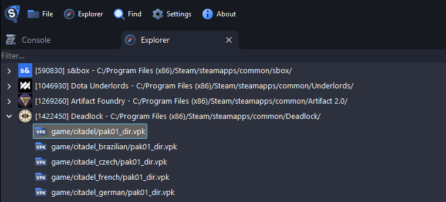

2. Type `models/heroes_staging/haze` into the box above the tree and press <kbd>Enter</kbd>. For other heroes, see [Finding a Hero's Model](../games/deadlock.md#finding-a-hero-s-model).

    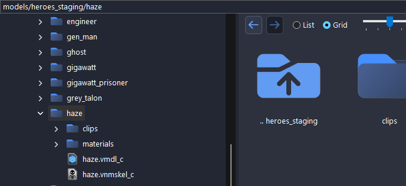

3. Double-click `haze.vmdl_c` to preview her. The **Animation** list in the sidebar plays her animations and shows their frame rate.

    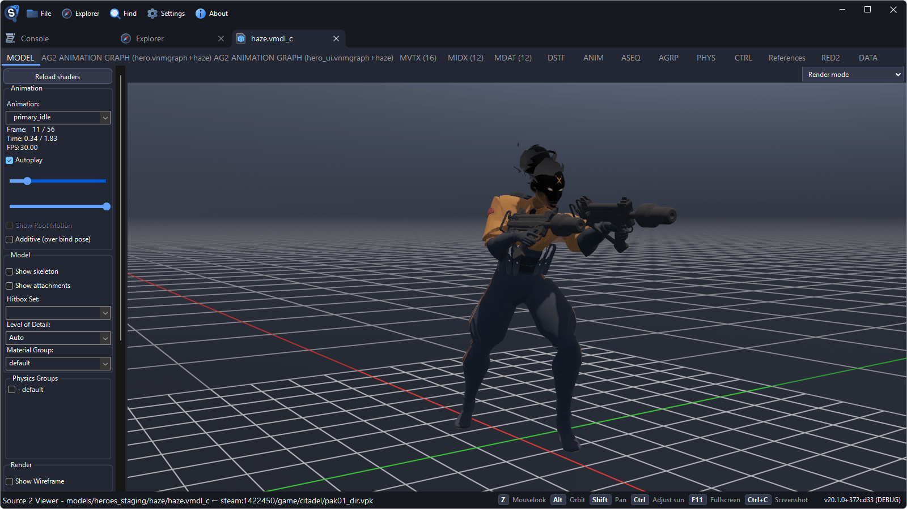

## Exporting to glTF

1. Right-click `haze.vmdl_c` and select **Decompile & export**.

    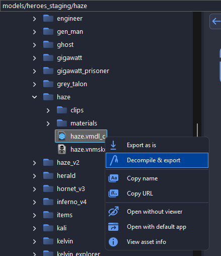

2. Choose an empty folder, set **Save as type** to **glTF** and click **Save**.

    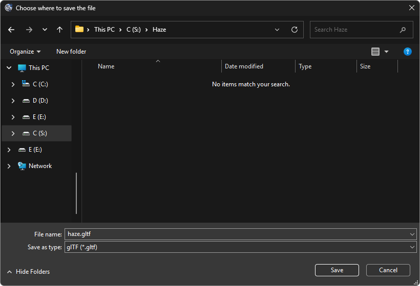

3. When the window says **Export completed**, click **Close**.

    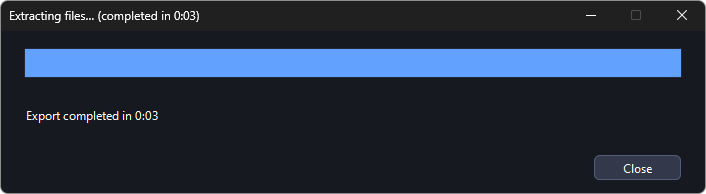

## Importing into Blender

### Preparing the Scene

Most Deadlock animations run at 30 frames per second, and Blender's default is 24. Set the frame rate before importing, as changing it later changes the playback speed.

1. Delete the default cube. Keep the camera and the light.
2. In the **Output** properties (the printer icon), set **Frame Rate** to **30**.

    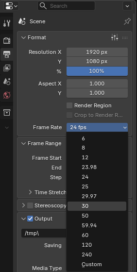

### Importing the glTF

1. Select **File > Import > glTF 2.0 (.glb/.gltf)**.

    

2. Select `haze.gltf`.

    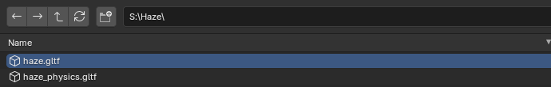

3. Under **Bones & Skin**, set **Bone Shape Scale** to **0.3**, so the bones do not [hide the model](./exporting-models.md#bones-look-like-big-spheres-in-blender).

    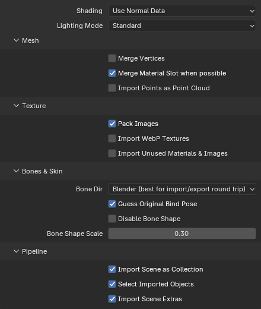

4. Click **Import glTF 2.0**.

With the mouse over the viewport, press <kbd>Numpad .</kbd> to zoom to her, and press <kbd>Z</kbd> and pick **Material Preview** to see her textures.

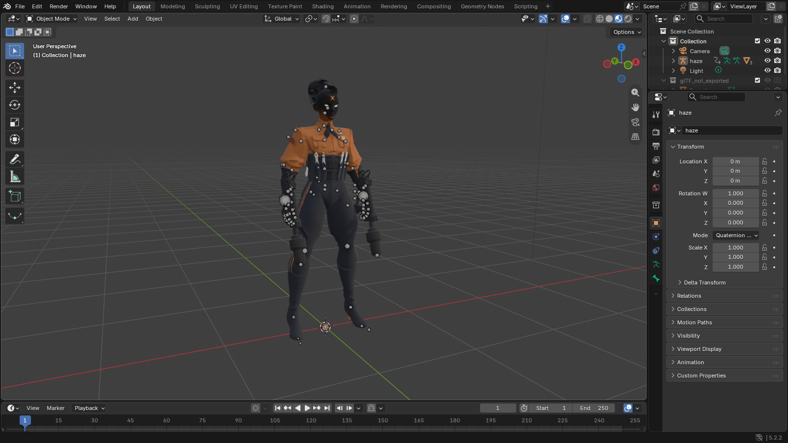

In the **Outliner**, `haze` is the armature, with her meshes below it.

## Posing the Character

1. The import leaves the animation `ref` assigned, which resets the bones whenever the frame changes. Click `haze` in the Outliner, open the **Object** properties (the orange square), expand **Animation** and click the **X** next to `ref`.

    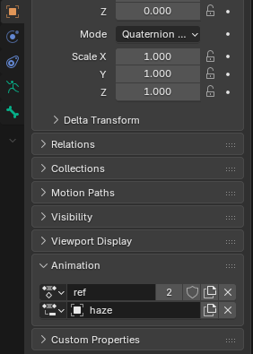

2. Switch to **Pose Mode**.

    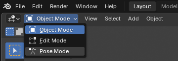

3. Click a bone, press <kbd>R</kbd> and move the mouse to rotate it.

    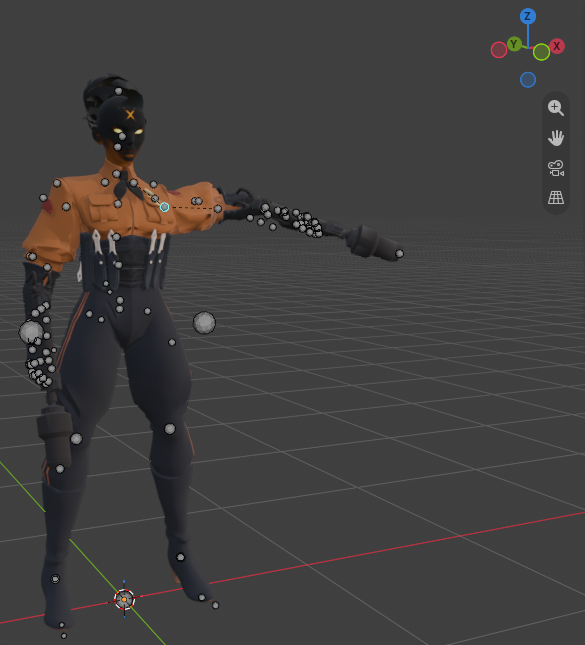

4. To start over, press <kbd>A</kbd> and select **Pose > Clear Transform > All**.

    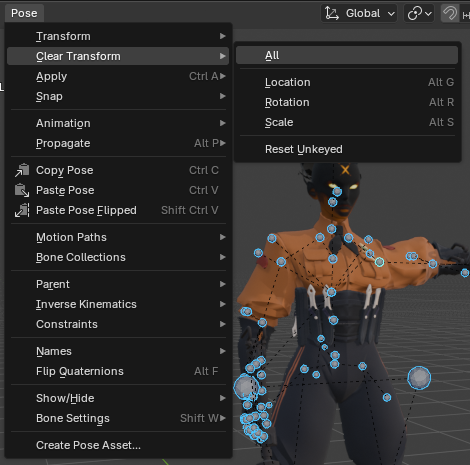

::: tip
To start from a frame of an animation, assign the animation as described below, go to that frame and click the **X** again.
:::

## Playing the Animations

1. In the **Animation** panel, click the button at the left of the first row and pick an animation, such as `primary_idle`.

    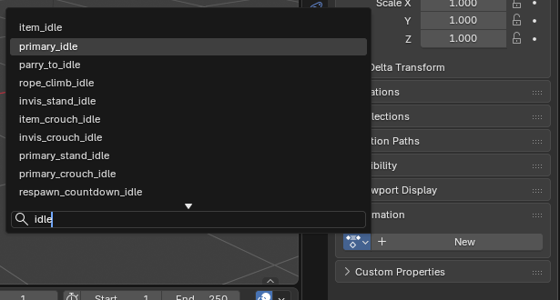

2. In the **Timeline**, set **Start** to `0` and **End** to the animation's last frame, such as `55`. The orange diamonds mark its keys.

    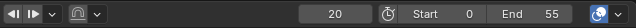

3. Press <kbd>Space</kbd> to play.

## Rendering an Image

1. The default world is nearly black. In the **World** properties (the red globe), set **Color** to white.

    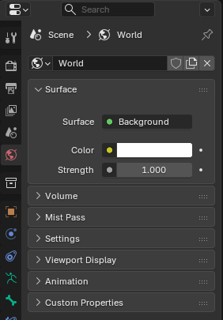

2. Frame Haze in the viewport, then select **View > Align View > Align Active Camera to View**.

    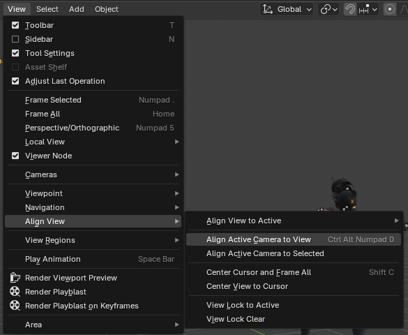

3. Select **Render > Render Image** (<kbd>F12</kbd>), and save it with **Image > Save As**.

    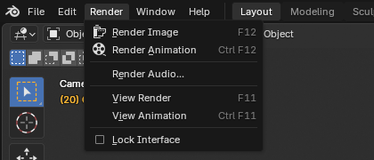

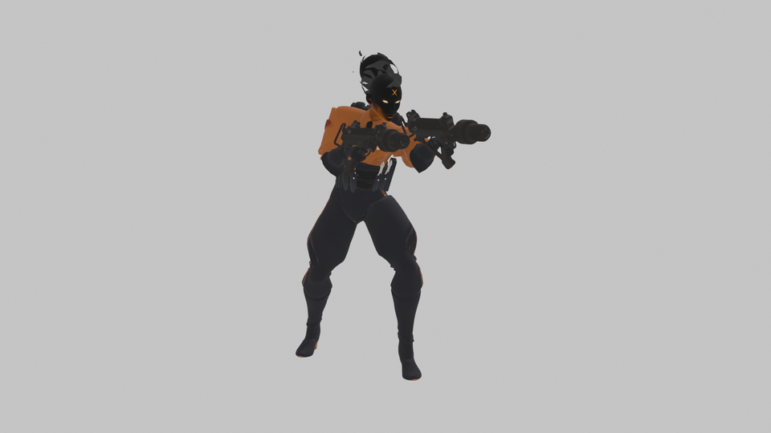
