# Exporting Maps

Source 2 Viewer exports maps to glTF for Blender and other 3D software, or decompiles them to `.vmap` for Hammer. The examples use Dust II from Counter-Strike 2, `maps/de_dust2.vmap_c` in `game/csgo/maps/de_dust2.vpk`, and Blender 5.2.

## Finding Maps

Each official map has its own package in the game's `maps/` folder. Workshop maps are listed in the Explorer under their game as `[Workshop <id>]`. Open them there rather than from a copy, so the textures they use from the game are found.

1. In the **Explorer** tab, type the map's name into the filter box and double-click its package.

    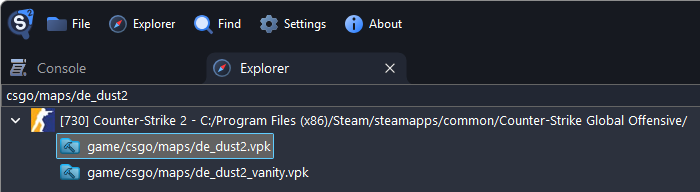

2. Open the `maps` folder. `de_dust2.vmap_c` is the map.

    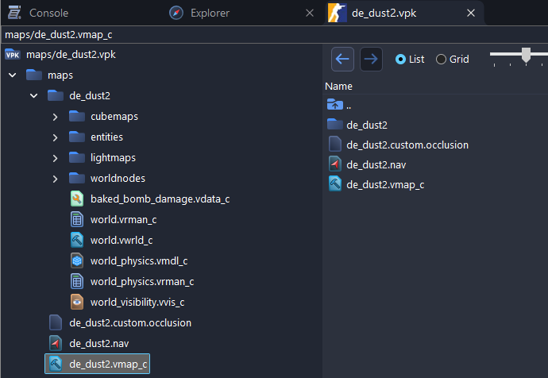

::: warning
Counter-Strike 2's `_vanity` packages, such as `de_dust2_vanity.vpk`, only hold the menu background scene, and Half-Life: Alyx's [`_commentary` packages](../games/half-life-alyx.md#maps) only the developer commentary. Use the package without the suffix.
:::

## Previewing Maps

Double-click `de_dust2.vmap_c` to open it.

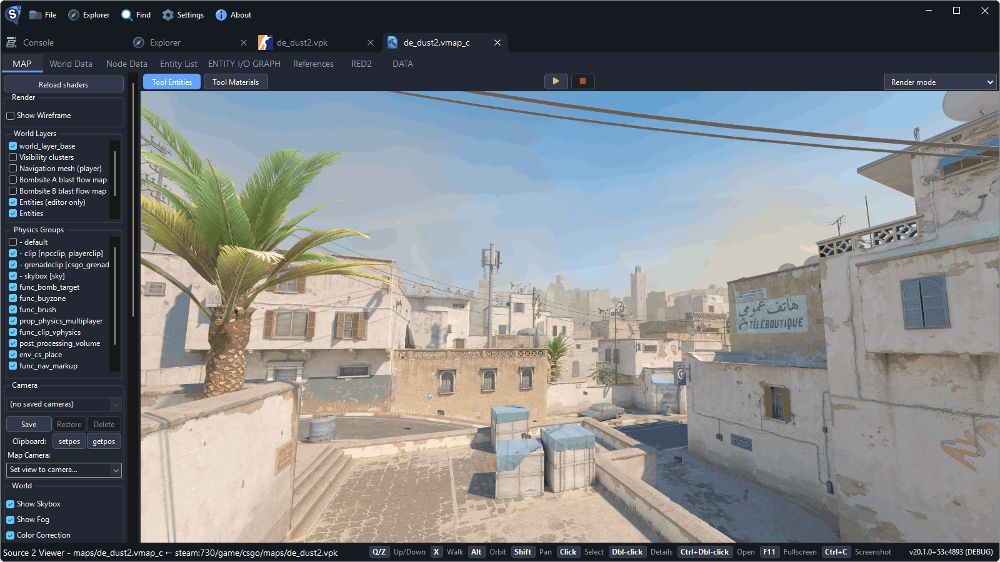

Click the 3D view, then:

- Drag to look around, and use <kbd>W</kbd><kbd>A</kbd><kbd>S</kbd><kbd>D</kbd> to move.
- Scroll to fly faster or slower.
- Hold <kbd>Alt</kbd> and drag to orbit, or <kbd>Shift</kbd> and drag to pan.

## Export to glTF

1. Right-click `de_dust2.vmap_c` and select **Decompile & export**.

    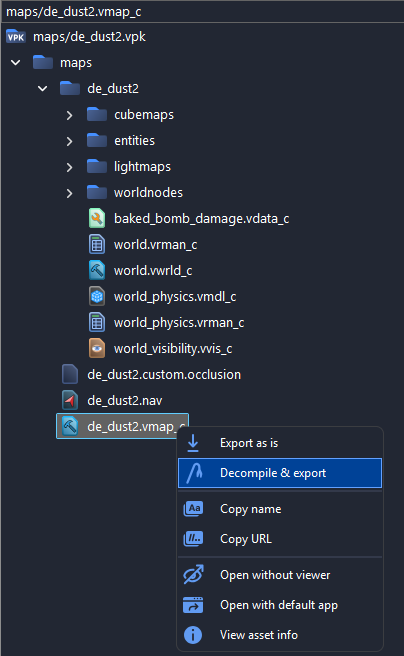

2. Click **OK** in the warning about decompiling maps.

3. Choose an empty folder, set **Save as type** to **glTF** and click **Save**.

    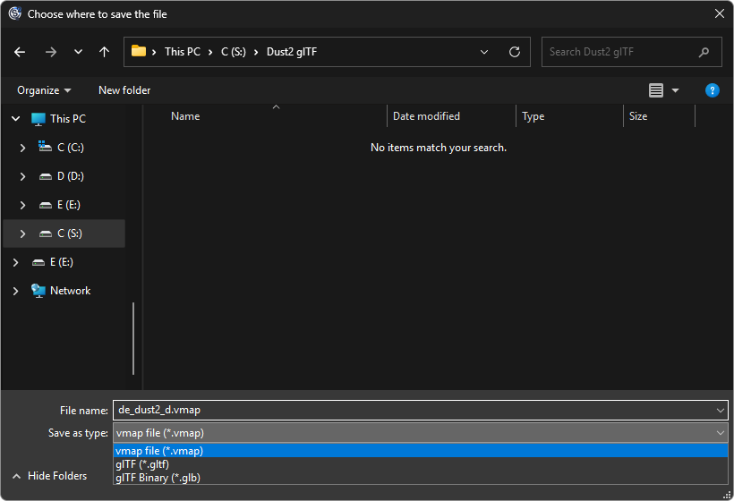

4. When the window says **Export completed**, click **Close**.

    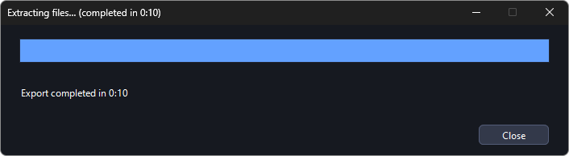

The export is large, with hundreds of textures for a map like Dust II. It holds the world, the props, decals, the materials and the sun. Brush entities such as bombsites and buy zones go into a second file, `de_dust2_d_physics.gltf`.

It leaves out baked lighting, point and spot lights, the sky and the 3D skybox. Blended materials, such as ground that mixes two textures, keep only their first texture.

### Importing into Blender

1. Delete the default cube.
2. Select **File > Import > glTF 2.0 (.glb/.gltf)**.

    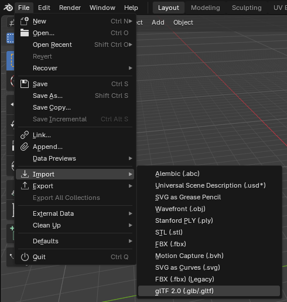

3. Select `de_dust2_d.gltf`, not the `_physics` file, and click **Import glTF 2.0**. A large map takes a while.

    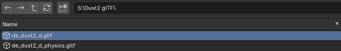

    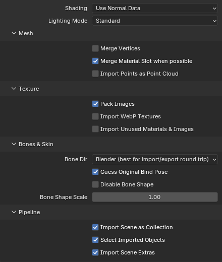

4. With the mouse over the viewport, press <kbd>Home</kbd> to see the whole map.
5. Press <kbd>Z</kbd> and pick **Material Preview** to see the textures.

    

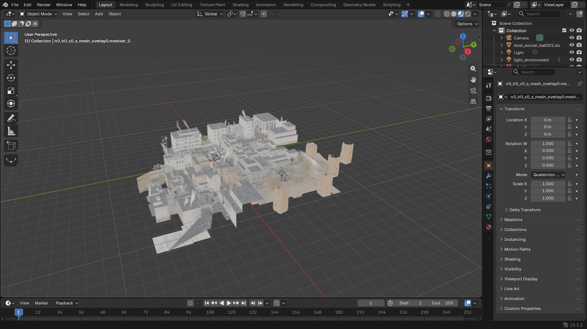

To fly through the map, select **View > Navigation > Walk Navigation** and move with <kbd>W</kbd><kbd>A</kbd><kbd>S</kbd><kbd>D</kbd>.

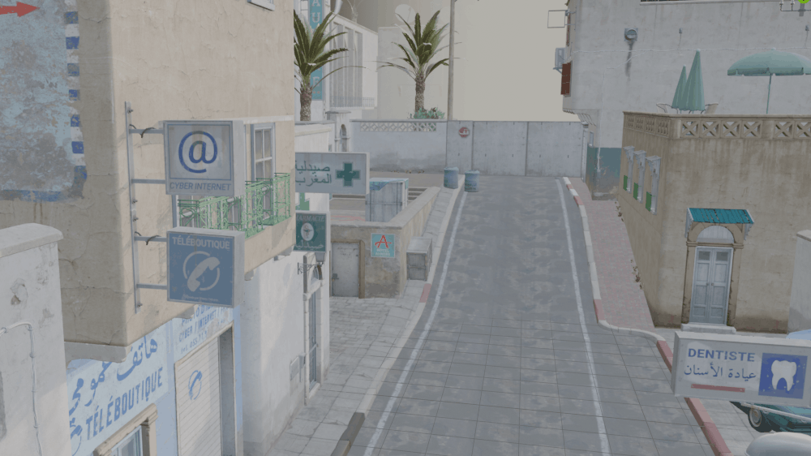

## Decompile to .vmap

Hammer comes with the game's Workshop Tools. In Steam, enable them under the game's **Properties > DLC**, launch them and create an addon.

1. Right-click `de_dust2.vmap_c`, select **Decompile & export** and click **OK** in the warning.
2. Go to the `maps` folder of your addon's content folder, keep **Save as type** at **vmap file** and click **Save**.

    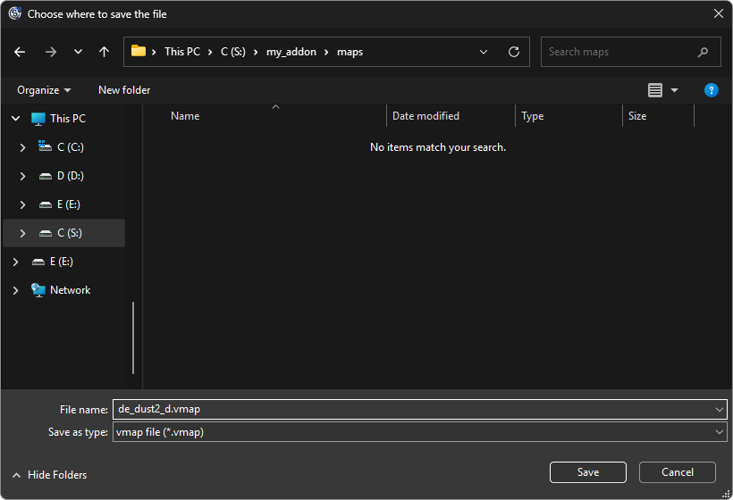

3. When the export is done, open `de_dust2_d.vmap` in Hammer.

The export writes a `de_dust2` folder next to the `.vmap`, with the models and materials made from the map:

```
Counter-Strike Global Offensive/content/csgo_addons/my_addon/
└── maps/
    ├── de_dust2_d.vmap
    └── de_dust2/
```

The 3D skybox is a separate map and is not decompiled with it.

::: danger
Do not use a decompiled map as your first mapping project if you are new to mapping! Decompiled output is messy and does not resemble how real `.vmap` files are made. Learn the basics of Hammer Editor first.
:::

::: warning
Compiling a map throws away much of how it was built, so decompiling can only rebuild an approximation. Props the compiler merged come back as one prop per material, and meshes come back as triangles and quads. [Format support](./format-support.md#maps-vmap) lists what the map compiler removes for good.
:::

## Batch Map Export

The [command-line utility](./command-line.md) exports maps without opening Source 2 Viewer. This exports Dust II to glTF:

```powershell
./Source2Viewer-CLI.exe -i "steam:730/game/csgo/maps/de_dust2.vpk" -f "maps/de_dust2.vmap_c" -o "de_dust2/de_dust2.gltf" --gltf_export_format gltf --gltf_textures_adapt
```

This exports every map of Counter-Strike 2, which takes tens of GB:

```powershell
./Source2Viewer-CLI.exe -i "steam:730/game/csgo/maps" --recursive_vpk -e vmap_c -o "exported" --gltf_export_format gltf --gltf_textures_adapt
```
