# Exporting Models

Source 2 Viewer exports models to glTF, which Blender and most other 3D software can import. The examples use Roshan from Dota 2, `models/creeps/roshan/roshan.vmdl_c`, and Blender 5.2.

## Finding Models

Models are `.vmdl_c` files in the game's main package:

| Game             | Folder                                            | Models                                                              |
| ---------------- | ------------------------------------------------- | ------------------------------------------------------------------- |
| Counter-Strike 2 | `agents/models/`                                  | Player agents                                                       |
| Counter-Strike 2 | `weapons/models/`                                 | Weapons and knives                                                  |
| Counter-Strike 2 | `models/`                                         | Props and other world models                                        |
| Dota 2           | `models/heroes/`                                  | Heroes and their default items                                      |
| Dota 2           | `models/items/`                                   | Cosmetic items                                                      |
| Dota 2           | `models/creeps/`                                  | Creeps and Roshan                                                   |
| Deadlock         | `models/heroes_staging/` and `models/heroes_wip/` | Heroes, see [Deadlock](../games/deadlock.md#finding-a-hero-s-model) |
| Half-Life: Alyx  | `models/characters/`                              | Characters                                                          |
| Half-Life: Alyx  | `models/creatures/`                               | Creatures                                                           |

1. In the **Explorer** tab, expand the game and double-click its main package, here `game/dota/pak01_dir.vpk`.

    

2. Type the folder, `models/creeps/roshan`, into the box above the tree and press <kbd>Enter</kbd>.

    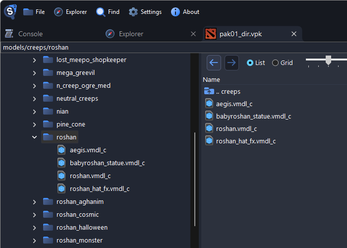

To find a model by name, use [search](./finding-files.md#searching-a-package).

## Previewing Models

Double-click a `.vmdl_c` file to open it.

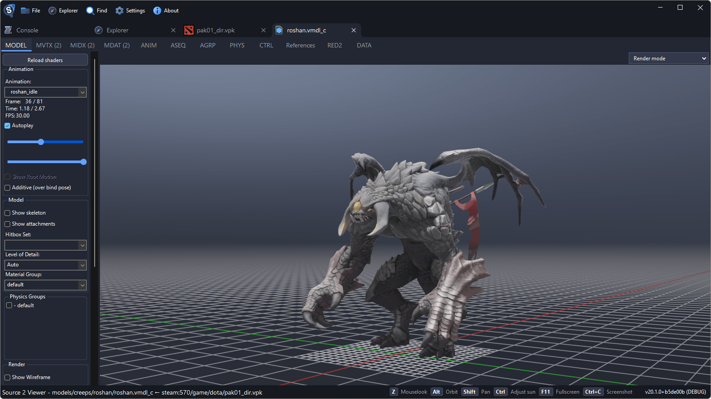

- Drag to look around, and use <kbd>W</kbd><kbd>A</kbd><kbd>S</kbd><kbd>D</kbd> to move.
- Hold <kbd>Alt</kbd> and drag to orbit around the model.
- Hold <kbd>Shift</kbd> and drag to pan.

The bar at the bottom of the window lists the other keys. The sidebar holds the model's animations, level of detail, material groups and, for models with optional parts, the **Mesh Group** list.

The **Animation** list at the top of the sidebar holds all animations of the model. Pick one to play it.

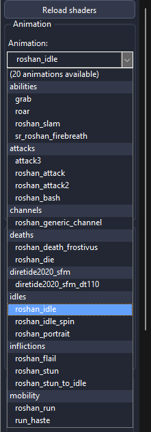

## Exporting to glTF

1. Right-click the model and select **Decompile & export**.

    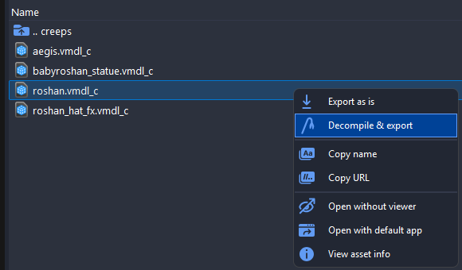

2. Choose an empty folder, as the export writes several files. Set **Save as type** to **glTF** or **glTF Binary** and click **Save**.

    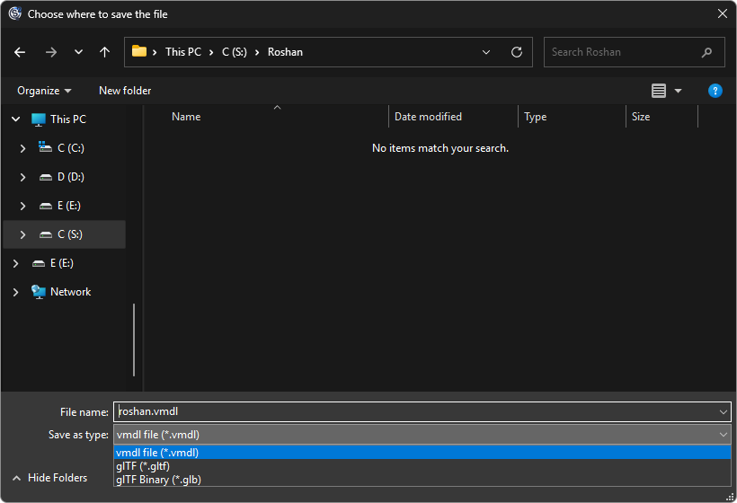

3. When the window says **Export completed**, click **Close**.

    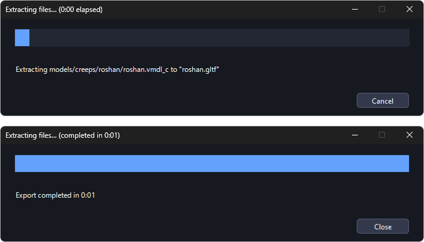

The export holds the most detailed meshes, the materials with their textures as PNG files, the skeleton, every animation and any morph targets. The collision shapes go into a second file, `roshan_physics.gltf`. Keep the files together.

## Importing into Blender

If you want the animations, set the frame rate first, as described in [Preparing the Scene](./characters-in-blender.md#preparing-the-scene). Most of Roshan's animations run at 30 frames per second, and Blender's default is 24.

1. Delete the default cube.
2. Select **File > Import > glTF 2.0 (.glb/.gltf)**.

    

3. Select `roshan.gltf`, not the `_physics` file.

    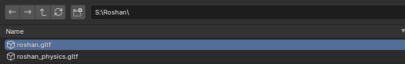

4. Under **Bones & Skin**, set **Bone Shape Scale** to **0.3**, see [below](#bones-look-like-big-spheres-in-blender). Click **Import glTF 2.0**.

    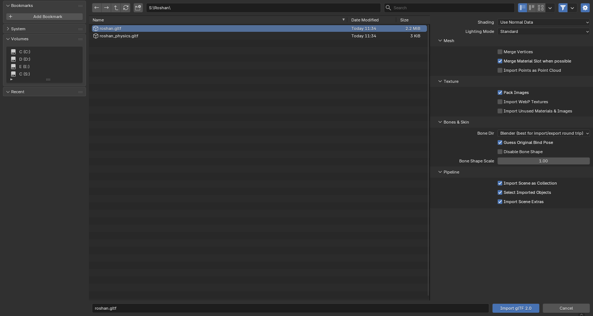

Press <kbd>Numpad .</kbd> over the viewport to zoom to the model, and press <kbd>Z</kbd> and pick **Material Preview** to see the textures. Each animation becomes an action, see [Posing Characters in Blender](./characters-in-blender.md).

### Bones look like big spheres in Blender

glTF stores no bone lengths, so Blender draws every bone as a sphere, and at the default size they hide much of the model, as on the left:

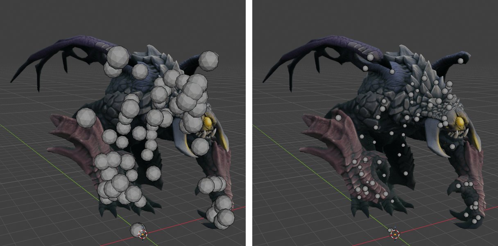

Set **Bone Shape Scale** under **Bones & Skin** in the import dialog to about **0.3**. Blender keeps the setting for the next import until you close it.

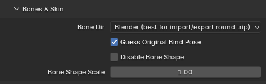

### Extra meshes in Blender

The export holds every mesh of the model, also those the game hides by default, so Blender shows all of them at once. A CS2 agent such as `agents/models/ctm_sas/ctm_sas_variantf.vmdl_c` comes with first-person arms and a defuse kit, and Paradox in Deadlock with a second gun on her hip. The **Mesh Group** list in the viewer shows which ones the model draws.

In Blender, the meshes are listed below the armature in the Outliner:

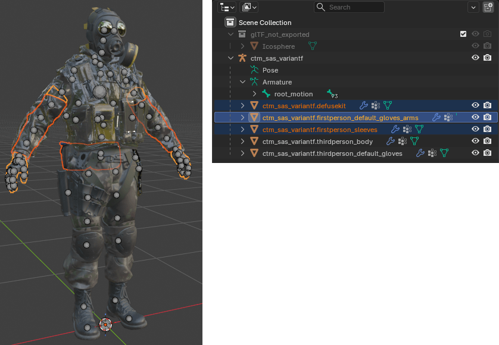

Right-click a mesh and select **Delete** to remove it. Hiding it with the eye icon still shows it in renders.

On the command line, `--gltf_mesh_list` exports only the meshes you name, such as `--gltf_mesh_list "thirdperson_body,thirdperson_default_gloves"`.

## Exporting Animations

The export always includes every animation. Characters with thousands of animations, such as CS2 agents, make a large file that Blender imports slowly. The [command-line utility](./command-line.md) can export only the ones you need:

```powershell
./Source2Viewer-CLI.exe -i "steam:570/game/dota/pak01_dir.vpk" -f models/creeps/roshan/roshan.vmdl_c -o "roshan/roshan.gltf" --gltf_export_format gltf --gltf_textures_adapt --gltf_animation_list "roshan_idle,roshan_run"
```

`--gltf_textures_adapt` exports the materials as Source 2 Viewer does.

Additive animations look crumpled on their own, and Blender cannot layer them. Add `--gltf_compose_additive` to export them as whole poses.
