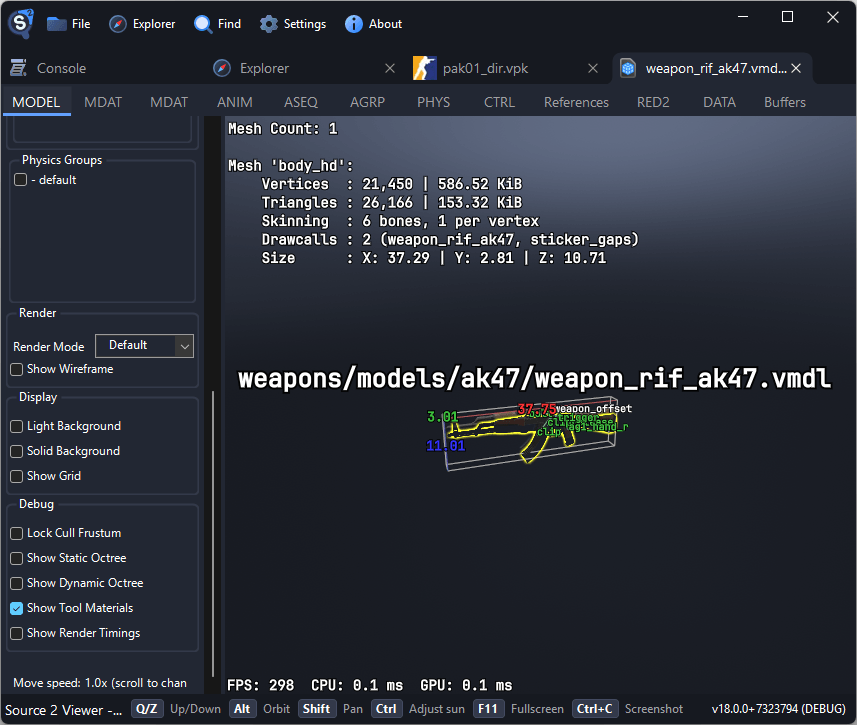

# Exporting Models

Source 2 Viewer can export 3D models from any Source 2 game to the standard glTF 2.0 format, which can be imported into Blender, Maya, 3ds Max, and other 3D software.

## Finding Models

Models are stored as `.vmdl_c` files inside VPK archives. In CS2, most assets are inside `pak01_dir.vpk`. Common locations:

| Game             | Path                                           | Examples                                         |
| ---------------- | ---------------------------------------------- | ------------------------------------------------ |
| Counter-Strike 2 | `weapons/models/`                              | Weapon viewmodels and worldmodels                |
| Counter-Strike 2 | `agents/models/`                               | Player and agent models                          |
| Counter-Strike 2 | `models/`                                      | Props, vehicles, foliage, and other world models |
| Dota 2           | `models/heroes/`                               | Hero models                                      |
| Dota 2           | `models/items/`                                | Cosmetic items, in a folder per hero             |
| Deadlock         | `models/heroes_wip/`, `models/heroes_staging/` | Hero models                                      |
| Half-Life: Alyx  | `models/characters/`                           | Characters and NPCs                              |

Use <kbd>Ctrl</kbd>+<kbd>F</kbd> to search for files by name.

### Deadlock hero models

Deadlock hero models are `.vmdl_c` files under `models/heroes_wip/` and `models/heroes_staging/`. Each hero has a folder named after its internal name, which can differ from its name in the game, and heroes move between these folders in game updates. See [Deadlock](../games/deadlock.md#finding-a-hero-s-model) for how to find a hero's model. Source 2 Viewer detects Deadlock automatically, so you can find its `pak01_dir.vpk` in the Explorer and browse to that folder from there. Double-click a model to preview it along with its animations. To use a hero in Blender, right-click the model and select **Decompile & export**, then choose glTF as described in [Exporting to glTF](#exporting-to-gltf).

## Previewing Models

Double-click a `.vmdl_c` file to open the 3D model viewer.

Controls:

- <kbd>Alt</kbd> + mouse drag to orbit the camera around the model
- <kbd>Shift</kbd> + mouse drag to pan the camera
- Scroll wheel to zoom in/out
- <kbd>Ctrl</kbd> + mouse drag to adjust the sun direction

The viewer shows the model with materials and textures applied. Use the toolbar to toggle wireframe, bounding boxes, and other debug overlays.

If the model has animations, they appear in a dropdown in the toolbar. Select an animation to preview playback. Relevant keyboard shortcuts are shown at the bottom of the viewer.



## Exporting to glTF

1. Open a `.vmdl_c` file in the viewer (or locate it in the file tree)
2. Right-click the file (or its tab) and select **Decompile & export**
3. Choose a save location and filename
4. Select the export format: **glTF** or **GLB**
5. Click Save

The output format can be chosen in the save dialog. For 3D use, choose glTF or GLB. You can also export to the decompiled `.vmdl` source format.

The glTF export includes geometry, materials, textures, and the skeleton (if present).

Textures that are self-illuminated in the game export as emissive textures, so they glow in glTF viewers and Blender.

### glTF vs GLB

| Format | Description                                             | Best for                          |
| ------ | ------------------------------------------------------- | --------------------------------- |
| glTF   | Separate `.gltf`, `.bin`, and PNG texture files         | Recommended for most use cases    |
| GLB    | Single binary file, with PNG texture files next to it   | Has a 2 GB size limit in the spec |

::: warning
GLB files are limited to 2 GB by the glTF spec. Use **glTF** instead, especially for large models or map exports.
:::

## Importing into Blender

Import the exported file with **File → Import → glTF 2.0 (.gltf/.glb)**. See [Importing Models and Maps into Blender](./importing-into-blender.md) for frame rate, characters with animations, Dota 2 cosmetics and material issues.

If the armature is covered in large spheres, see [Bones look like big spheres in Blender](./importing-into-blender.md#bones-look-like-big-spheres-in-blender).

## Exporting Animations

Models with animations export them automatically when using the GUI.

Additive animations are exported as delta tracks by default. Use `--gltf_compose_additive` on the command line to compose them over the bind pose instead.

Animation keys that linear interpolation reproduces within a small tolerance are dropped. Use `--gltf_keep_all_keyframes` on the command line to write a key for every frame.

For batch animation export via the command line:

```sh
Source2Viewer-CLI -i "model.vmdl_c" -o "output.gltf" -d \
    --gltf_export_format gltf \
    --gltf_export_animations \
    --gltf_animation_list "idle,walk,run"
```

See the [command-line utility guide](./command-line.md) for more options.
