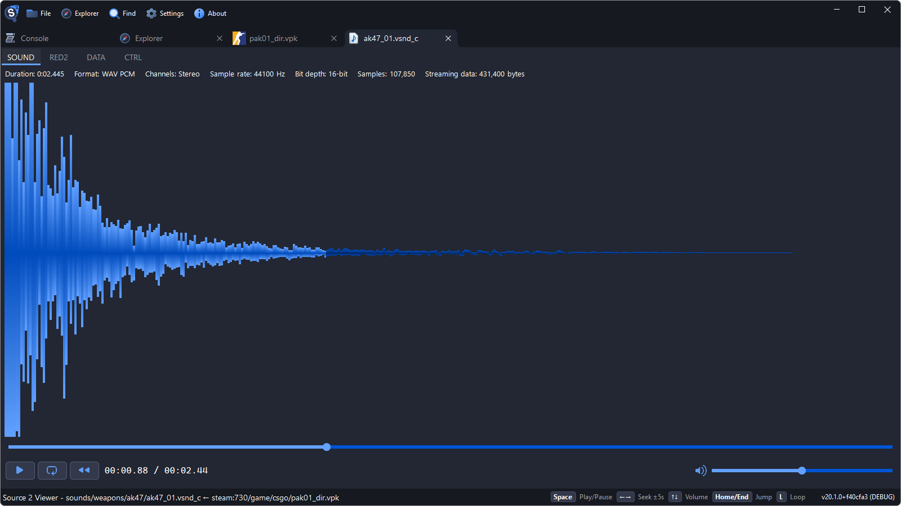
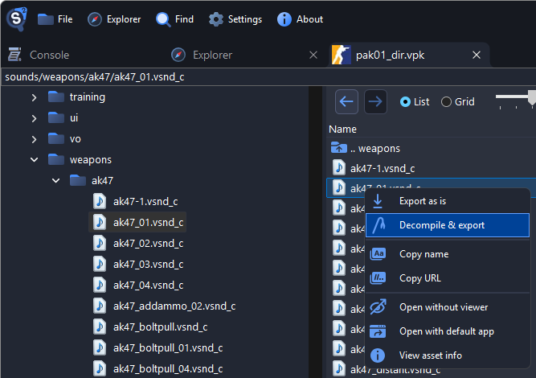
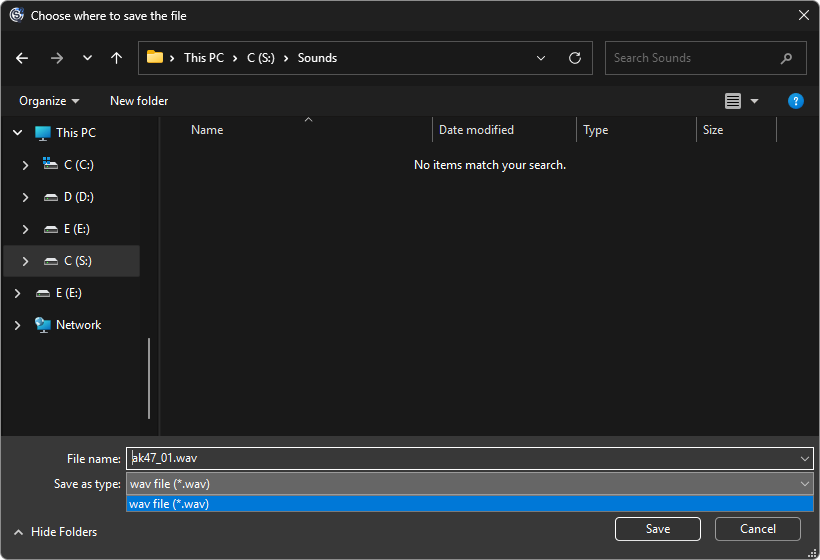
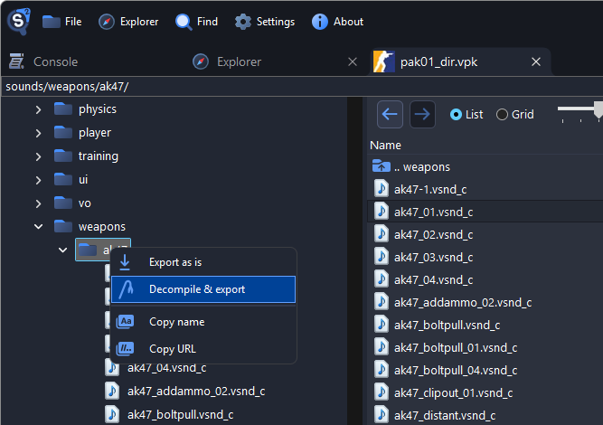
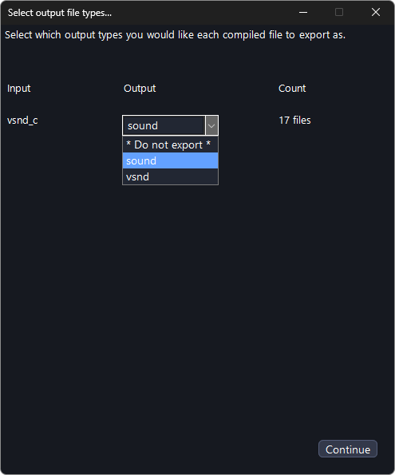

# Exporting Sounds

Source 2 Viewer plays sounds and exports them as WAV or MP3 files. The examples use files from Counter-Strike 2's `game/csgo/pak01_dir.vpk`.

## Finding Sounds

Sounds are `.vsnd_c` files in the `sounds/` folder, sorted into subfolders such as:

- `sounds/weapons/`, such as `sounds/weapons/ak47/`
- `sounds/vo/` for voice lines
- `sounds/music/`
- `sounds/ui/` for the interface
- `sounds/ambient/`

## Audio Player

Double-click a `.vsnd_c` file to open it, and press play.



Click in the waveform to jump to a position. The buttons below it play, loop and restart the sound.

With **Preview files after selecting** and **Auto play sounds** turned on in **Settings**, a sound plays as soon as you select it.

## Exporting a Sound

1. Right-click the sound and choose **Decompile & export**.

    

2. Choose a folder and click **Save**. The sound is saved as WAV or MP3, as the game stores it, with a `.vsnd` file of its settings and, for lip-synced voice lines, a `.txt` file.

    

3. A window shows when the export is done.

    

## Exporting a Folder

1. Right-click a folder and choose **Decompile & export**.

    

2. Keep **sound** for `vsnd_c`.

    

3. Click **Continue** and choose the folder to export to.

    

## Command Line

This exports every sound in the AK-47's folder with the [command-line utility](./command-line.md):

```powershell
./Source2Viewer-CLI.exe -i "steam:730/game/csgo/pak01_dir.vpk" -o "exported" -d --vpk_extensions "vsnd_c" --vpk_filepath "sounds/weapons/ak47/"
```

To turn an MP3 or WAV file into a `.vsnd_c`, compile it with the game's Workshop Tools.

## Sound Events

Games play most sounds through sound events in the `soundevents/` folder. An event names its sounds and how they play. In Counter-Strike 2, `Weapon_AK47.Single` in `soundevents/game_sounds_weapons.vsndevts_c` picks one of three AK-47 shots:

```
Weapon_AK47.Single =
{
	type = "csgo_mega"
	volume = 1.1
	mixgroup = "Weapons"
	vsnd_files_track_01 =
	[
		"sounds/weapons/ak47/ak47_02.vsnd",
		"sounds/weapons/ak47/ak47_01.vsnd",
		"sounds/weapons/ak47/ak47_04.vsnd",
	]
}
```
