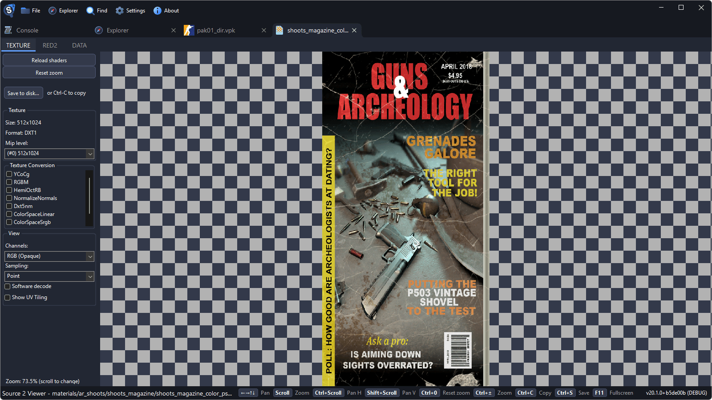
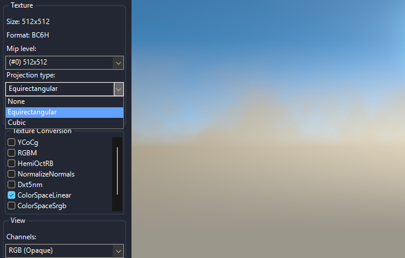
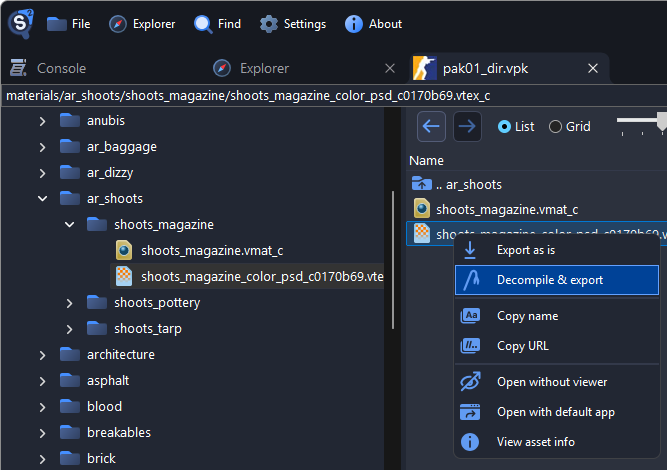
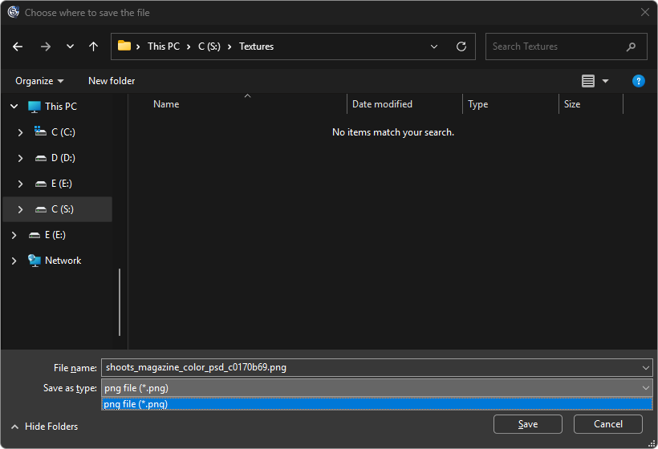
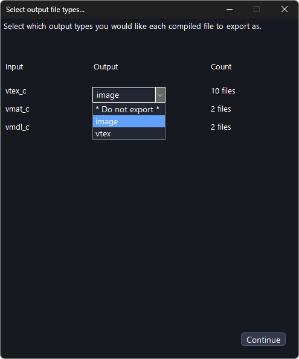

# Exporting Textures

Source 2 Viewer shows textures and exports them as images. The examples use files from Counter-Strike 2's `game/csgo/pak01_dir.vpk`.

## Finding Textures

Textures are `.vtex_c` files, mostly in `materials/` folders or next to a model, such as `weapons/models/ak47/materials/`. Interface images are in `panorama/images/`.

A texture is named after the image it was made from, followed by a hash: `ak47_default_color_psd_5b66a23b.vtex_c` was made from `ak47_default_color.psd`. The [References](./finding-files.md#references) tab of a material lists its textures.

## Texture Viewer

Double-click a `.vtex_c` file to open it. Scroll to zoom and drag to pan.



### Channels

Many textures keep different data in each channel, such as roughness in red and metalness in green. The texture itself does not say what its channels hold: the shader of the material that uses it decides that. Pick what to show in **Channels**:


- **Red**, **Green**, **Blue** and **Alpha** show one channel in gray.
- **RGB (Opaque)** ignores the alpha channel, and **RGBA (Transparent)** uses it as transparency.
- **RGB | A** and **R | G | B | A** show the channels next to each other, or one above the other for textures wider than they are tall.

Textures open as **RGB (Opaque)**, except vector graphics and particle textures, which open as **RGBA (Transparent)**.

### Cubemaps

Skies use cubemaps, such as `materials/skybox/sky_de_dust2_exr_908a35ba.vtex_c`. **Projection type** shows them as a panorama, a cross of six faces, or one face at a time.



HDR textures, such as this sky, export as EXR with their full brightness range.

## Saving What the Viewer Shows

**Save to disk...** in the sidebar saves the texture as the viewer shows it, with the picked channels or projection. HDR textures can also be saved as EXR. See [Saving Textures as Images](./screenshots.md#saving-textures-as-images).

## Exporting a Texture

1. Right-click the texture and choose **Decompile & export**.

    

2. Choose a folder and click **Save**.

    

3. A window shows when the export is done.

    

Textures are written as PNG, HDR textures as EXR, and textures stored as JPEG or WebP keep that format. A texture compiled from a `.vtex` file of its own is saved as that `.vtex`, with the image next to it. The exported image keeps the alpha channel.

**Decompile & export** on a material writes the `.vmat` and its textures, with textures that pack several maps split into one image each.

## Exporting a Folder

1. Right-click a folder and choose **Decompile & export**.

    

2. Keep **image** for `vtex_c`. Set `vmat_c` to `* Do not export *` to get every texture under its own name instead of through its materials.

    

3. Click **Continue** and choose the folder to export to.

    

## Command Line

This exports every texture in the AK-47's folder with the [command-line utility](./command-line.md):

```powershell
./Source2Viewer-CLI.exe -i "steam:730/game/csgo/pak01_dir.vpk" -o "exported" -d --vpk_extensions "vtex_c" --vpk_filepath "weapons/models/ak47/"
```

Add `--texture_decode_flags "ForceLDR"` to write HDR textures as PNG.

To turn an image into a `.vtex_c`, compile it with the game's Workshop Tools.

## Texture Names

The end of a texture's name usually tells what it holds:

- `_color`: the base color
- `_normal`: the normal map
- `_rough`: roughness
- `_ao`: ambient occlusion
- `_mask`: masks
