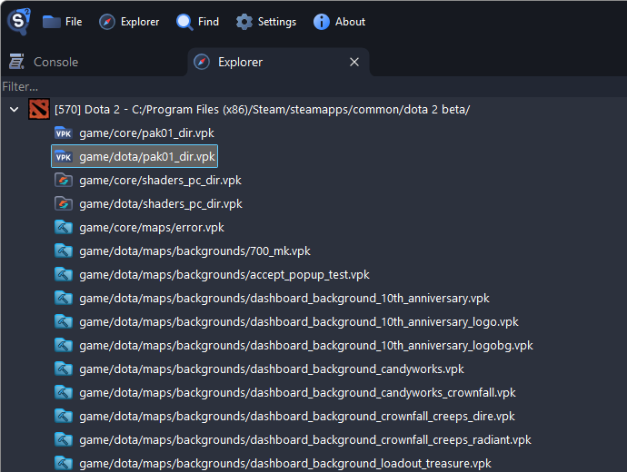
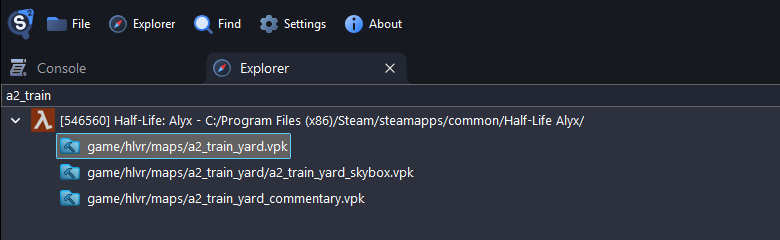
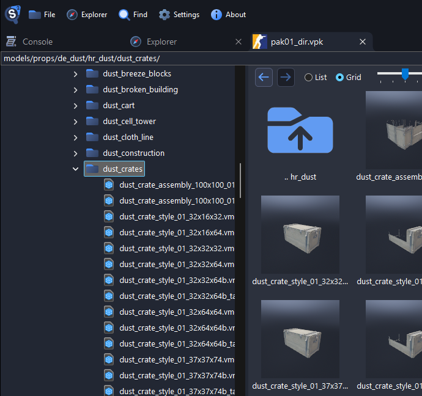
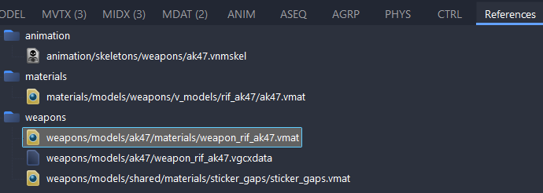
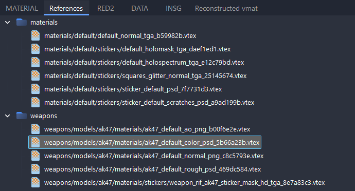
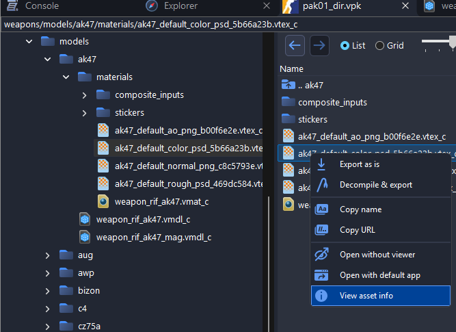
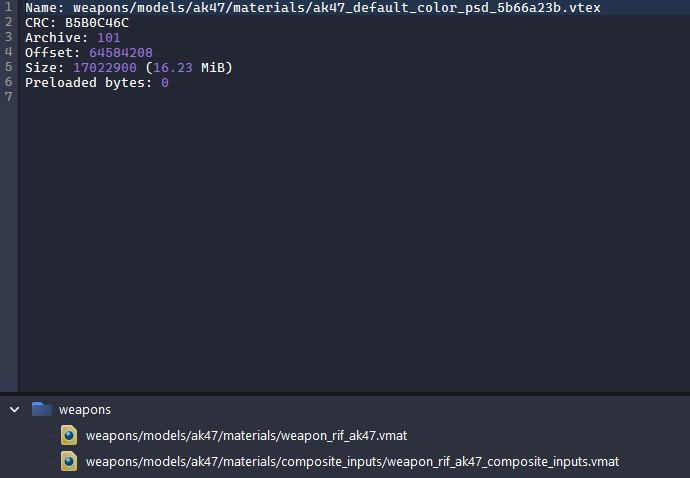

# Finding Game Files

Source 2 games keep almost all of their files in VPK packages. This guide shows which package to open and how to find a file in it.

## How a Game Folder Is Laid Out

A game installs into `steamapps/common/<game>/` in your Steam library, with its files in a `game/` folder:

- `game/<mod>/pak01_dir.vpk`, such as `game/csgo/pak01_dir.vpk`, is the main package, with the models, materials, sounds and almost everything else.
- `game/<mod>/maps/` has one package per map, such as `game/csgo/maps/de_dust2.vpk`.
- Folders ending in `_addons` hold addons, such as those made with the Workshop Tools.

Workshop items are in `steamapps/workshop/content/<appid>/<item id>/`, and the Explorer lists those that have a VPK. SteamVR Home is in `SteamVR/tools/steamvr_environments/game/steamtours/`.

| Game              | App ID  | Install folder                    | Game folder |
| ----------------- | ------- | --------------------------------- | ----------- |
| Counter-Strike 2  | 730     | `Counter-Strike Global Offensive` | `csgo`      |
| Dota 2            | 570     | `dota 2 beta`                     | `dota`      |
| Deadlock          | 1422450 | `Deadlock`                        | `citadel`   |
| Half-Life: Alyx   | 546560  | `Half-Life Alyx`                  | `hlvr`      |
| Aperture Desk Job | 1902490 | `Aperture Desk Job`               | `steampal`  |
| Artifact Classic  | 583950  | `Artifact`                        | `dcg`       |
| Artifact Foundry  | 1269260 | `Artifact 2.0`                    | `dcg`       |
| Dota Underlords   | 1046930 | `Underlords`                      | `dac`       |

In `vpk:` links and on the command line, `steam:<appid>/` stands for the install folder, such as `steam:730/game/csgo/pak01_dir.vpk`.

## Where Files Are in a Package

Most games use the same top-level folders. The examples are from Dota 2:

| Folder         | What it holds                              | Example                                   |
| -------------- | ------------------------------------------ | ----------------------------------------- |
| `models/`      | Models                                     | `models/heroes/juggernaut/`               |
| `materials/`   | Materials and textures                     | `materials/models/heroes/juggernaut/`     |
| `particles/`   | Particle systems                           | `particles/units/heroes/hero_juggernaut/` |
| `sounds/`      | Sounds                                     | `sounds/vo/juggernaut/`                   |
| `soundevents/` | Sound events, which define how sounds play | `soundevents/game_sounds_heroes/`         |
| `panorama/`    | The user interface and its images          | `panorama/images/heroes/`                 |
| `scripts/`     | Game data                                  | `scripts/npc/`                            |
| `resource/`    | Localization text                          | `resource/localization/`                  |

The game pages, such as [Counter-Strike 2](../games/counter-strike-2.md), list the folders of each game.

A map package holds the compiled map, `maps/<map>.vmap_c`, and a `maps/<map>/` folder with its world, lighting and entities. Its materials and textures come from the main package.

## Finding a Package in the Explorer

The **Explorer** tab lists your installed Steam games that have VPK packages, with those packages and their workshop items. Double-click a package to open it.

Type in the filter box at the top to show only the packages whose path contains the text.

## Browsing a Package

A package opens in its own tab, with a folder tree on the left and the files of the selected folder on the right.

- Type a path into the box above the tree, such as `models/props/de_dust/hr_dust/dust_crates/`, and press <kbd>Enter</kbd> to go there. Paths are case-sensitive.
- The arrow buttons, and the back and forward buttons of your mouse, go back and forward.
- **List** shows names, sizes and types, and **Grid** shows thumbnails.

## Searching a Package

Press <kbd>Ctrl</kbd>+<kbd>F</kbd> in a package tab to search the whole package:

- **File Name (Partial Match)** finds files whose name contains the text.
- **File Name (Exact Match)** finds files with exactly that name.
- **File Full Path** finds files whose path contains the text.
- **Regex** matches a regular expression against file names, such as `^weapon_.*\.vmdl_c$`.
- **File Contents (Case Sensitive)** finds files that contain the text. It reads every file, so it is slower.
- **File Contents Hex Bytes** finds files that contain the bytes.

The results do not show the folder of a file. Right-click a result to select it in the tree.

## References

The **References** tab of an open file lists the files it uses, such as the materials of a model:

Double-click a reference to open it, or press <kbd>Ctrl</kbd>+<kbd>C</kbd> to copy its path. The References tab of a material lists its textures:

### Files That Use a File

To see which files use a file, right-click it and choose **View asset info**.

The files that use it are listed at the lower left. This list is available in Counter-Strike 2, Dota 2, Half-Life: Alyx and SteamVR Home.

## Which Package a File Is In

The bottom left corner of the window shows the file in the active tab and the package it was opened from.

Right-click a file and choose **Copy URL** to copy a [`vpk:` link](./getting-started.md#vpk-links) with the package, or **Copy name** for only its path.

If a model or material shows up without its textures, see [Game Search Paths](./game-search-paths.md).
