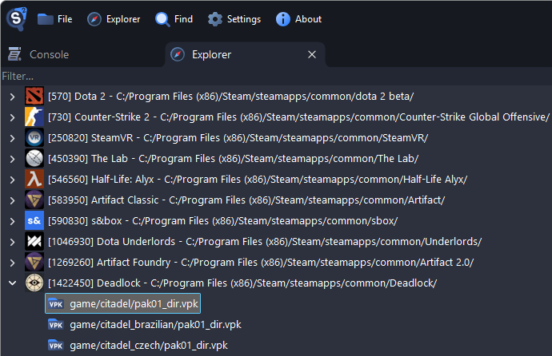
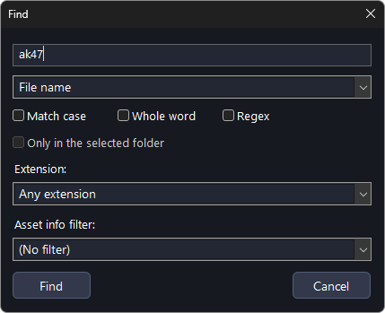
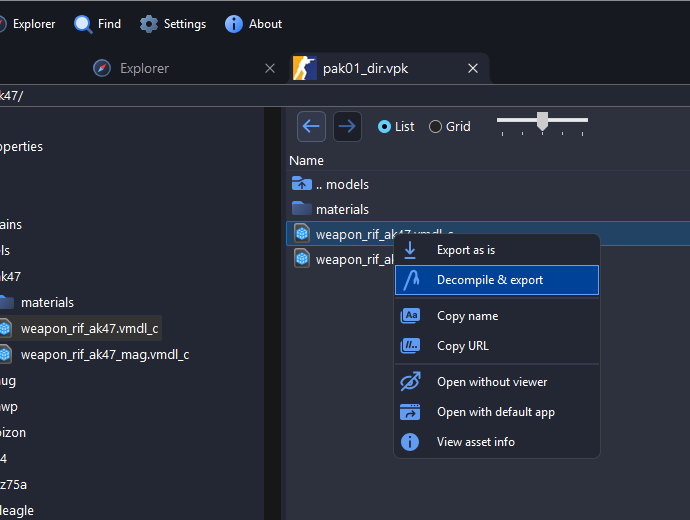
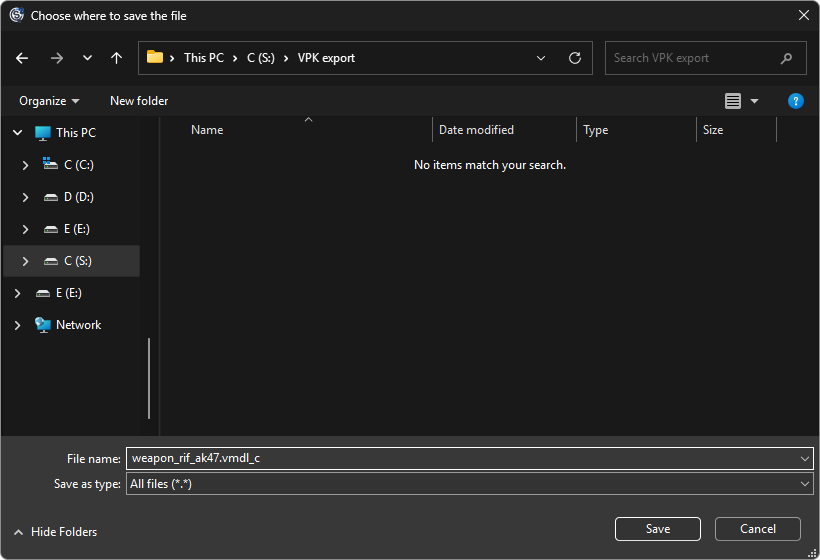
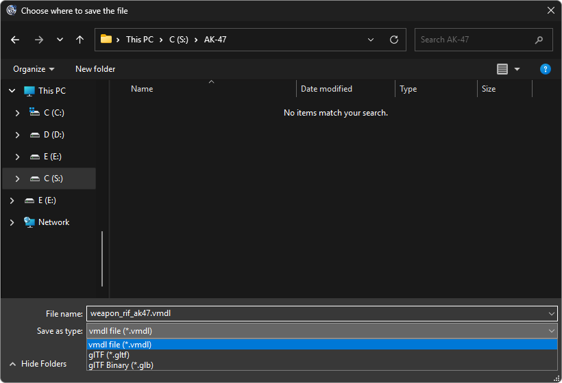
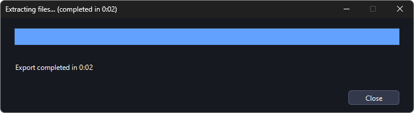
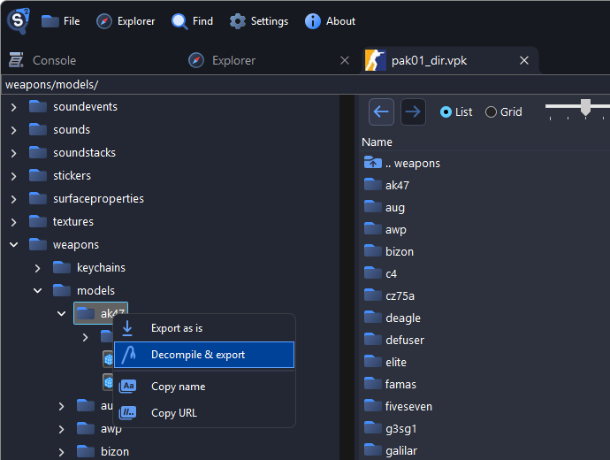
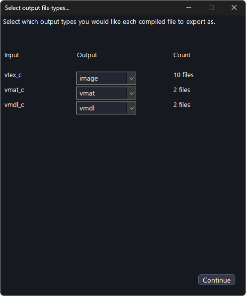
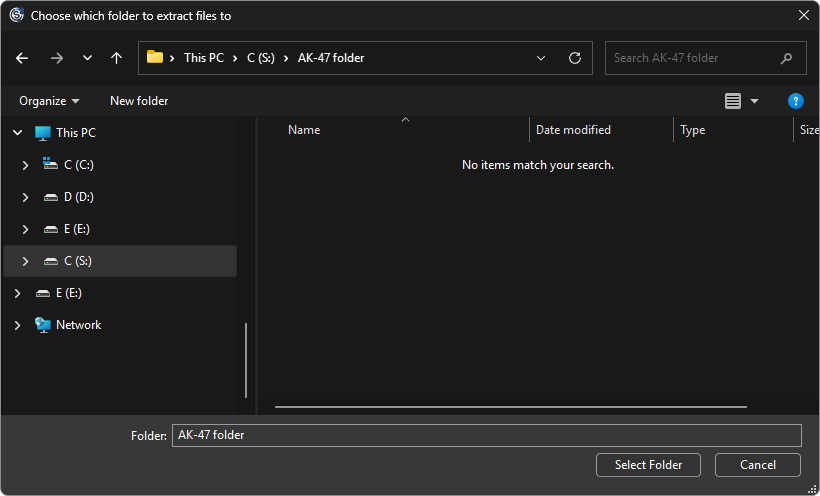

# Getting Started

## Downloading Source 2 Viewer

Download the latest release from [s2v.app](https://s2v.app). It needs no installation.

Games update their files often, and the release can fall behind. If a file fails to open, switch to the [latest dev build](./reporting-issues.md#getting-the-latest-dev-build), which has the newest fixes. You can also download it from [s2v.app/dev](https://s2v.app/dev/).

- **Source 2 Viewer** (GUI) is Windows-only, and runs on Linux and macOS with Wine.
- **Source2Viewer-CLI** (command-line) runs on Windows, Linux and macOS.

## Using the Explorer

The **Explorer** tab lists your installed Steam games that have VPK packages, with those packages and their workshop items. Expand a game and double-click a package to open it. See [Finding Game Files](./finding-files.md) for which package holds what.

Right-click a package or file and choose **Add to Bookmarks** to keep it at the top of the Explorer. Recently opened files are listed there too.



Files opened from a game folder load the textures, materials and other files they use from that game. For files outside of a game folder, see [Game Search Paths](./game-search-paths.md).

## Opening Files

- **File > Open** (<kbd>Ctrl</kbd>+<kbd>O</kbd>) opens a `.vpk` or a single Source 2 file, such as a `.vmdl_c`.
- You can also drag files onto the window.

### VPK Links

A `vpk:` link opens a file inside a package:

```
vpk:steam:730/game/csgo/maps/de_dust2.vpk:maps/de_dust2.vmap_c
```

Right-click a file and choose **Copy URL** to get its link. `steam:730/` stands for the install folder of the Steam app 730, so the link works on any computer with the game. After **Register .vpk file association** in settings, clicking a `vpk:` link opens it in Source 2 Viewer.

## Searching

Press <kbd>Ctrl</kbd>+<kbd>F</kbd> in a package tab to search the package by file name, path or contents. See [Searching a Package](./finding-files.md#searching-a-package).



## Previewing Files

Double-click a file to open it in a new tab. Models, maps, textures, sounds, materials and particles each get their own viewer, and other files open as text, or in a hex view if they are binary. The keys of each viewer are listed in the bar at the bottom of the window.

A file that uses other files, such as a model and its materials, lists them in its **References** tab. See [References](./finding-files.md#references).

## Exporting Files

Right-click a file to export it:



- **Export as is** saves the compiled file unchanged.

    

- **Decompile & export** converts it to a format you can edit:
    - Models and maps: glTF for Blender, or `.vmdl` and `.vmap` for the Workshop Tools
    - Textures: PNG, or EXR for HDR textures, with the texture's `.vtex` if it has one of its own
    - Sounds: WAV or MP3, with a `.vsnd` of their settings
    - Materials: `.vmat`
    - Other files: their text format

Pick the format in **Save as type**. For a model, **glTF** or **glTF Binary** gives a file you can open in Blender. For a map, a warning about what decompiled maps lack comes first.



A window shows the progress and tells you when the export is done.



## Exporting Folders

Select several files with <kbd>Ctrl</kbd> or <kbd>Shift</kbd>, or right-click a folder, to export them together.



**Decompile & export** first asks for the format of each file type. Pick `gltf` or `glb` for `vmdl_c` to get models for Blender, or `* Do not export *` to skip a type. If the selection contains a map, every type except the map starts as `* Do not export *`.



Then choose the folder to export to. The files keep their folders from the package.



For large exports, the [command-line utility](./command-line.md) is faster.

## Help

Ask questions on [Discord](https://discord.gg/s9QQ7Wg7r4), and report bugs as described in [Reporting Issues](./reporting-issues.md).
