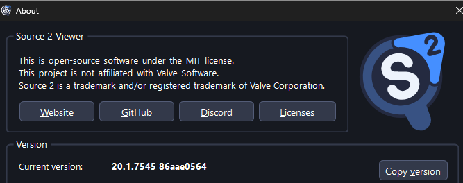
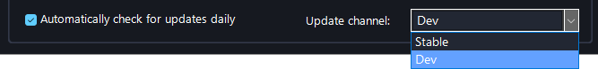
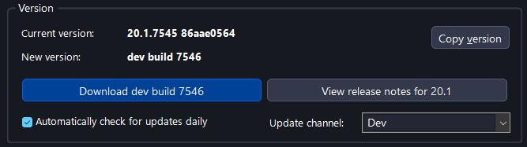
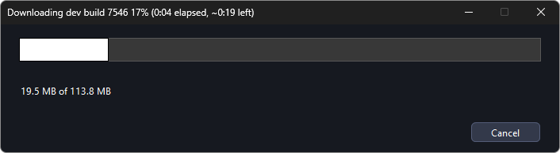
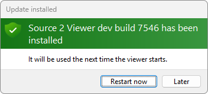

# Reporting Issues

Found a bug? Post it on
[GitHub](https://github.com/ValveResourceFormat/ValveResourceFormat/issues). That's the
whole guide. Everything below is just how to do it well.

## Before You Report

1. **Try the [latest dev build](#getting-the-latest-dev-build)**, not the release. Your bug
   might already be fixed. The issue form will ask about this.
2. **[Search existing issues](https://github.com/ValveResourceFormat/ValveResourceFormat/issues?q=is%3Aissue)**.
   Somebody may have beaten you to it. If so, add your details there instead of opening a
   duplicate.
3. **Check the [format support page](./format-support.md)**. Some things that look like
   bugs are known limitations of what can be decompiled or exported.

## Getting the Latest Dev Build

Dev builds have fixes that the last release does not have yet.

1. Click **About** in the bar at the top of the window.

    

2. **Copy version** copies your version, Windows version and graphics card for a bug report.

    

3. Set **Update channel** to **Dev**.

    

4. Click **Download dev build**.

    

    

5. Click **Restart now**, or **Later** to update the next time you start Source 2 Viewer.

    

To go back to the release, set **Update channel** to **Stable**. Dev builds can also be
downloaded from [s2v.app/dev](https://s2v.app/dev/), which versions up to 20.1 need.

## Why GitHub and Not Discord

Discord is chat: a bug posted there scrolls away and is forgotten by next week. A GitHub
issue stays open until it's fixed, notifies you when it is, and saves the next person from
reporting it again. If a bug only exists in a Discord message, it basically doesn't exist.

Discord is still great for questions and "is this even a bug?", but once the answer is
yes, take the two minutes and file it. Linking the Discord conversation in the issue is
welcome.

## Writing a Good Bug Report

[Open a bug report](https://github.com/ValveResourceFormat/ValveResourceFormat/issues/new?template=bug_report.yml)
and fill in the form. What it asks for, and why:

- **What happened, and what you expected instead.** Screenshots help a lot.
- **The error text or stacktrace**, if there is one. Paste the whole thing, don't
  screenshot text.
- **The game and the file that breaks.** This is the most important part: without the
  exact file path, nobody can reproduce your bug. For example:
  `models/heroes/hoodwink/hoodwink.vmdl_c` from Dota 2. If it's a workshop item, link the
  workshop page.
- **Your version.** Click **Copy version** in the
  [About window](#getting-the-latest-dev-build) and paste it.

A report with a file path and an error message usually gets looked at quickly. A report
that says "models are broken" with no file gets a reply asking for the file, and then
everyone waits.

## Feature Requests

Also GitHub:
[open a feature request](https://github.com/ValveResourceFormat/ValveResourceFormat/issues/new?template=feature_request.yml).
Describe the problem you're trying to solve, not just the feature you want; there might be
a better way to solve it than what you had in mind.

## AI-Assisted Contributions

Pull requests written with AI tools and coding agents are welcome. But you are the author:
actually read the code before submitting, understand what it does, and test it. The code
should be proper, idiomatic C# that fits the rest of the codebase, not whatever the model
produced on the first try. If a reviewer can tell that no human ever looked at it, it's
slop, and it wastes everyone's time.

Same goes for words: don't let an agent write your issue, your PR description, or your
comments. A short paragraph in your own words beats generated filler every time. Nobody
wants to read text that you couldn't be bothered to write.
