# Screenshots and Image Export

Source 2 Viewer copies the 3D view to the clipboard, and saves textures, vector graphics and graphs as images. The examples use files from Deadlock.

## Copying the 3D View

1. Open a model, map or particle system, such as `models/heroes_staging/haze/haze.vmdl_c`, and frame it.
2. Click the 3D view, then press <kbd>Esc</kbd> to clear the selection the click made.
3. Press <kbd>Ctrl</kbd>+<kbd>C</kbd> and paste the image anywhere.

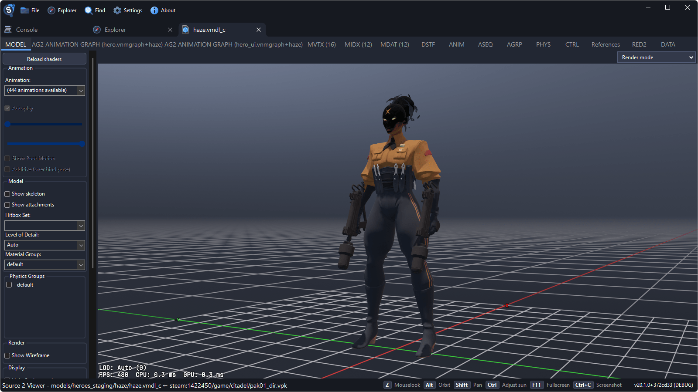

Models are copied on a transparent background. Maps and particle systems are copied as shown, with their background.

The copy is as large as the 3D view. For a larger one, press <kbd>F11</kbd> for full screen before copying.

## Setting Up the Shot

### Level of Detail

Set **Level of Detail** in the sidebar to **LOD 0** to keep the most detailed version of the model when it is small in the view.

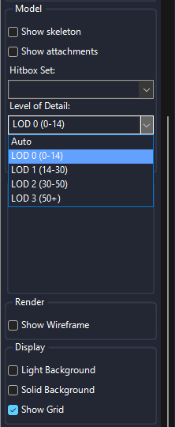

### Backgrounds

The **Display** group in the sidebar has **Light Background**, **Solid Background** and **Show Grid**. **Solid Background** gives a flat magenta, or green with **Light Background**, which is the way to get a particle effect on a flat color. **Pause** holds the effect still.

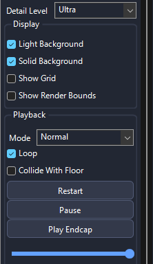

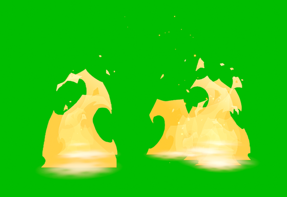

### Settings

The **Video settings** in **Settings** set **Anti-aliasing**, **Camera FOV**, **Max texture size** and **Shadow quality**. **Camera FOV** applies when you go back to the tab. Reopen the file after changing the others.

## Maps

- Turn off **Tool Entities** above the 3D view to hide the entity markers.
- **Save** and **Restore** in the **Camera** group keep a view to come back to.
- **Map Camera** moves the view to a camera placed in the map.
- **Exposure** sets the brightness.

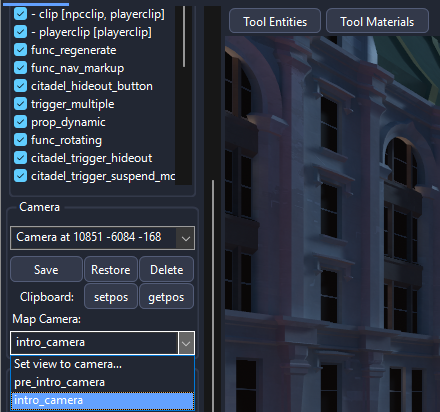

## Saving Textures as Images

This example saves Haze's hero card, `panorama/images/heroes/haze_card_psd.vtex_c`.

1. Open the texture and pick what to save in **Channels**. **RGBA (Transparent)** keeps the transparency.

    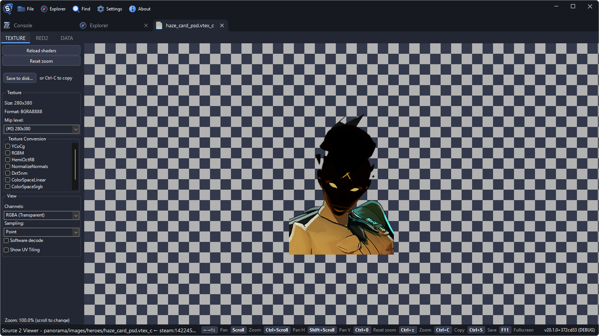

    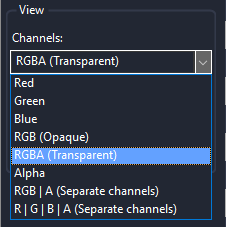

2. Click **Save to disk...** or press <kbd>Ctrl</kbd>+<kbd>S</kbd>.

    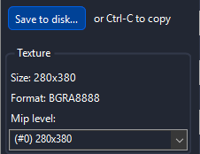

3. Pick **PNG Image** or **JPG Image**, or **EXR Image** for HDR textures, and click **Save**.

    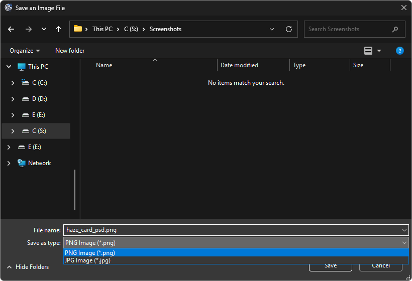

The image is saved at the full size of the texture. JPG has no transparency, so transparent parts turn black:

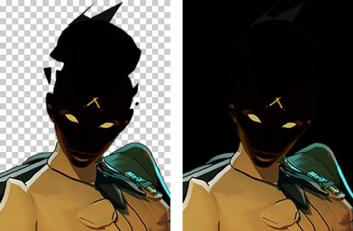

## Exporting Vector Graphics

Panorama vector graphics (`.vsvg_c`), such as `panorama/images/builds/citadel_build_tag_damage.vsvg_c`, open in the texture viewer too.

1. Click **Save to disk...**.
2. Pick **SVG** to save the original file, or **PNG** or **JPG** with a **Resolution**.

    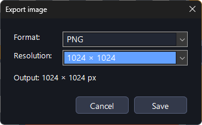

3. Click **Save** and choose where to save it.

    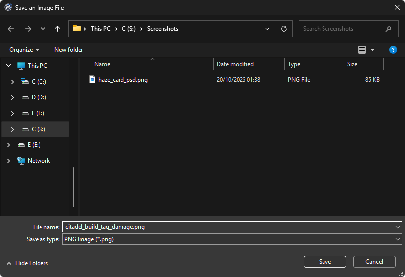

## Saving Graphs

Animation graphs, Pulse graphs and entity I/O graphs have a **Save to disk...** button in the sidebar too, which saves the whole graph.

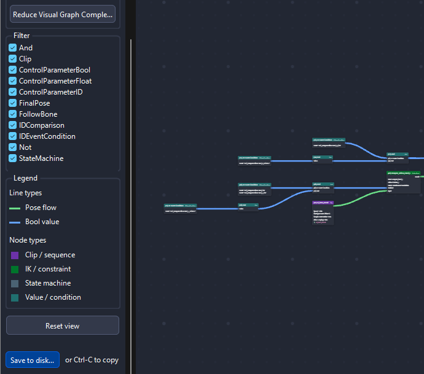
