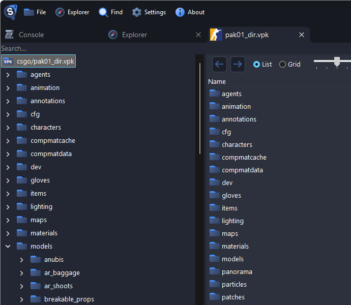
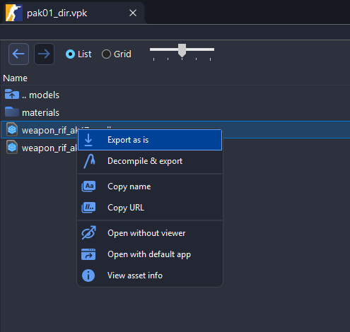
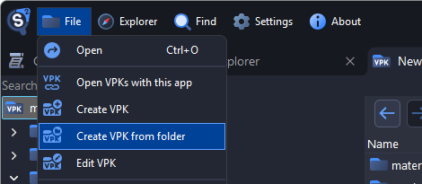
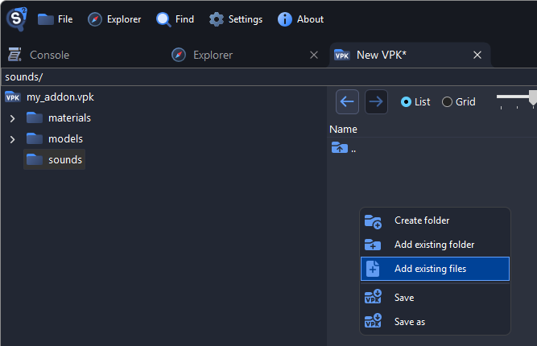
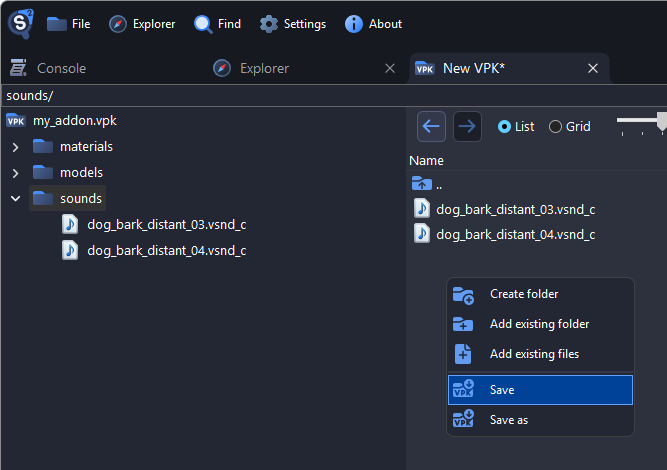
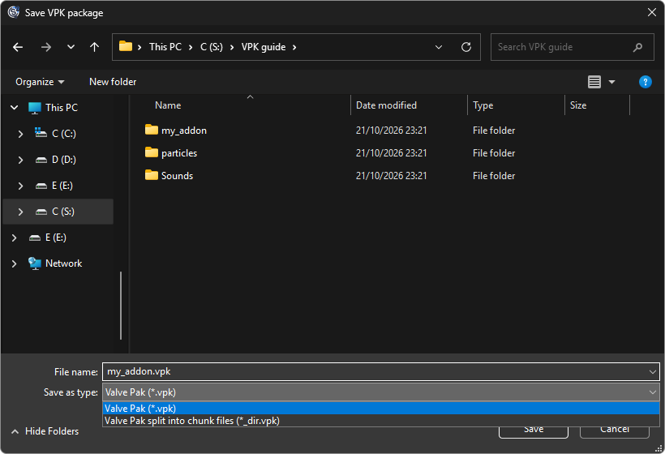
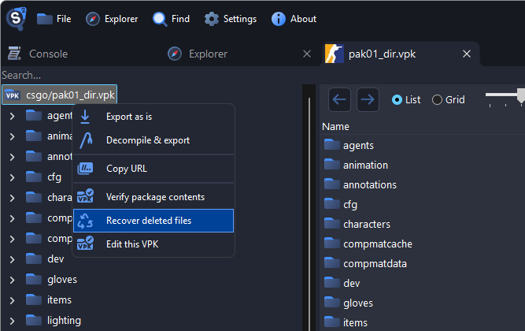
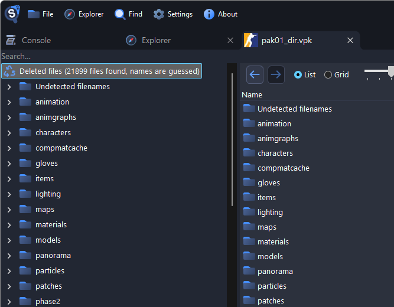

# How to Open, Extract and Edit VPK Files

VPK (Valve Pak) is the archive format Source and Source 2 games pack their files into. Large packages are split into a `pak01_dir.vpk` index and numbered chunk files such as `pak01_000.vpk`. Source 2 Viewer can open, extract, create and edit them.

## Browsing VPK Archives

- Open a VPK with File > Open or from the Explorer. For a split package, open the `_dir.vpk`.
- VPKs inside other VPKs, such as maps in workshop items, open with a double-click.
- To check a package, right-click the root and select **Verify package contents**.



See [Finding Game Files](./finding-files.md) for which package to open and how to find a file in it.

## Extracting Files

Right-click a file, a folder, or the root of the tree for the whole VPK, then choose:

- **Export as is** to save it unchanged
- **Decompile & export** to convert it to formats you can edit, see [Exporting Folders](./getting-started.md#exporting-folders)



To extract a whole VPK with the [command-line utility](./command-line.md), add `-d` to decompile the files:

```sh
Source2Viewer-CLI -i "pak01_dir.vpk" -o "output_folder/" -d
```

## Creating and Editing VPK Archives

1. In the **File** menu, choose **Create VPK**, **Create VPK from folder** or **Edit VPK**. You can also right-click the root of an open VPK and select **Edit this VPK**.

    

2. Right-click in the editing tab to add, rename and remove files and folders.

    

3. Press <kbd>Ctrl</kbd>+<kbd>S</kbd>, or right-click and select **Save** or **Save as**. To split the VPK into chunk files, pick **Valve Pak split into chunk files** and name it `*_dir.vpk`. A single-file VPK can also be named `*_dir.vpk`, such as `pak05_dir.vpk` for a mod, and stays a single file when you add files and save.

    

    

To pack a folder into a VPK on the command line:

```sh
Source2Viewer-CLI -i "my_addon" --vpk_create "my_addon.vpk"
```

### Good to Know

- Saving removes the VPK's signature, so games that check signatures won't load it.
- A single-file VPK must stay under 2 GiB. Save bigger ones split into chunk files.
- In a split VPK, added files go into chunk files right away and stay there even if you don't save. A `*_dir.vpk` without chunk files counts as a single file.

## Recovering Deleted Files

Chunk files can still contain files that a game update removed or replaced.

1. Open a split package such as `pak01_dir.vpk`.
2. Right-click the root and select **Recover deleted files**.

    

3. Recovered files appear under **Deleted files**, and files whose names can't be guessed under **Undetected filenames**.

    

::: warning
Recovered files can be incomplete, corrupted or from older game versions.
:::

## VPK File Format

Source 2 Viewer reads and writes VPKs with the [ValvePak](https://www.nuget.org/packages/ValvePak/) library, which you can also use in your own programs. The [Source 2 Wiki](https://www.source2.wiki/FileFormats/vpk) describes the format.
